<div align="center">

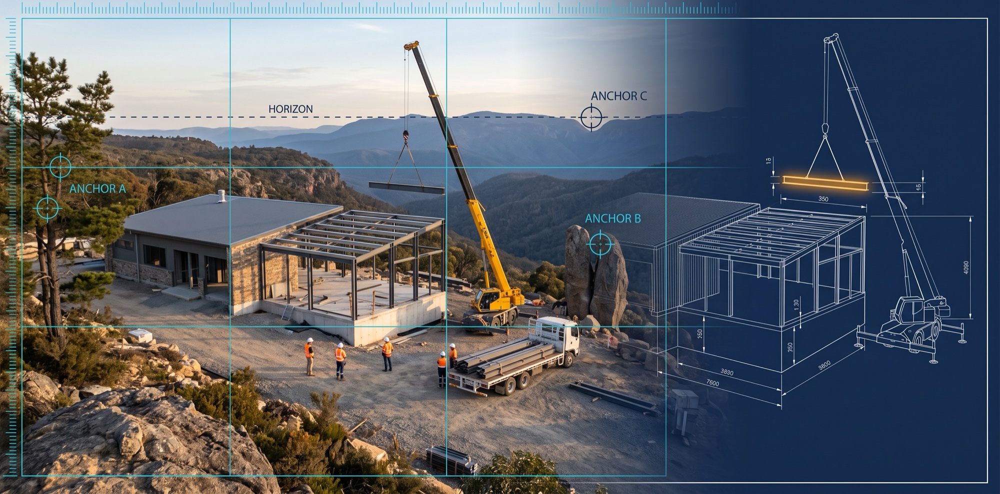

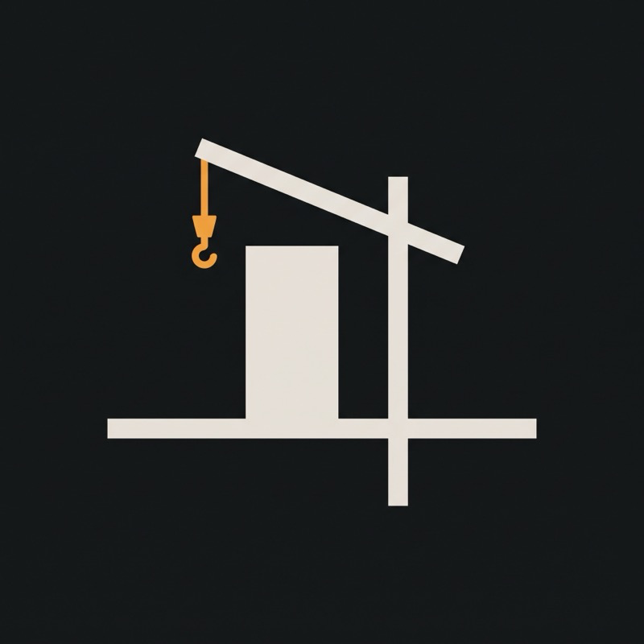

# 🏗️ timelapse_md

**A docs-as-code production system for AI-generated construction & restoration timelapse films**
**Yapay zekâ ile üretilen inşaat ve restorasyon timelapse filmleri için belge-kod üretim sistemi**

[🇬🇧 English](#-english) · [🇹🇷 Türkçe](#-türkçe) · [🎬 Film catalog / Film kataloğu](#-film-catalog--film-kataloğu) · [🎨 Image prompts / Görsel promptları](#-readme-image-prompts--readme-görsel-promptları)

</div>

---

> 📸 **Snapshot / Anlık görüntü — 16.10.2026.** Every number in this README comes from `bash araclar/sayac.sh` on that date.
> The repo's own rule is _"a number lives in one place"_ — for live numbers, run the counter.
> Bu README'deki her sayı o tarihte `bash araclar/sayac.sh` çıktısından alındı. Depo kuralı _"sayı tek yerde durur"_:
> güncel sayı için sayacı çalıştırın.

---

# 🇬🇧 English

## 1. What is this?

`timelapse_md` is **not a video repository**. It is the complete _paper side_ of an AI timelapse studio: every film is
planned, prompted, gated, logged and reviewed here as Markdown, and checked by small Bash/Python tools before a single
frame is generated.

Each film shows one fictional structure being built or restored from a **single locked-off camera**: a wind turbine on an
empty ridge, a rusty railway carriage that becomes a cliffside restaurant, a flooded theatre in a forest pit. The images and
clips are generated with external image-to-image and image-to-video (I2V) models. This repo decides **what** those models
are asked for, **in which order**, and **how the result is judged**.

```
STORY APPROVAL → ANALYSIS → PLAN → MASTER FRAME → PROMPTS → PROMPT GATE → TOOL GATE → PILOTS
      → REVERSE KEYFRAME CHAIN → I2V CLIPS → EDIT → CUT / EXPORT CHECKS → 5-LENS QA → RELEASE
```

The system is built on one discipline: **a lesson is a measured failure.** Every rule in the guides points back to a film,
a scene and a second where something broke. Unmeasured ideas are kept apart as _assumptions_ with an open/closed status.

## 2. At a glance

|                                             |                                             count | source                                            |
| ------------------------------------------- | ------------------------------------------------: | ------------------------------------------------- |
| 🎬 Film folders                             |              **62** (48 vertical · 14 horizontal) | `dikey_shorts/` · `yatay_*_dk_filmler/`           |
| 📄 Films with plan / QA spec                |                                 62 / 62 · 61 / 62 | `sayac.sh` (THE SKY STATION spec not written yet) |
| 📓 Films with a production log              |                                           31 / 62 | `sayac.sh` (QA cannot open without one)           |
| ⛓️ Plans on the two-keyframe chain          |                                           56 / 62 | `KILAVUZ_REHBERI §2.7`                            |
| 📚 Measured lessons                         |                                           **100** | `kilavuzlar/DERSLER.md`                           |
| 🧪 Coded assumptions & plan readings        | 444 (⬜ open 404 · ✅ measured 33 · ❌ dropped 7) | `VARSAYIMLAR.md` · `PLAN_OKUMALARI.md`            |
| 🔬 Research prompts / processed raw reports |                                           35 / 49 | `arastirma/`                                      |
| 📘 Guide files                              |                                36 (≈17,600 lines) | `kilavuzlar/`                                     |
| 🔍 QA lenses (current system)               |             5 · 3 films measured (15 raw reports) | `QA/Q1…Q5` · `QA/TABLO.md`                        |
| 🗄️ Archived QA raw reports (12-lens system) |  **393** raw reports · 37 films · 31 film reports | `QA/ARSIV_12_MERCEK/`                             |
| 🛠️ Tools                                    |                         11 scripts (≈2,400 lines) | `araclar/`                                        |
| 📝 Markdown in the repo                     |                       ≈980 files · ≈171,000 lines | —                                                 |

## 3. The core idea — the two-keyframe chain

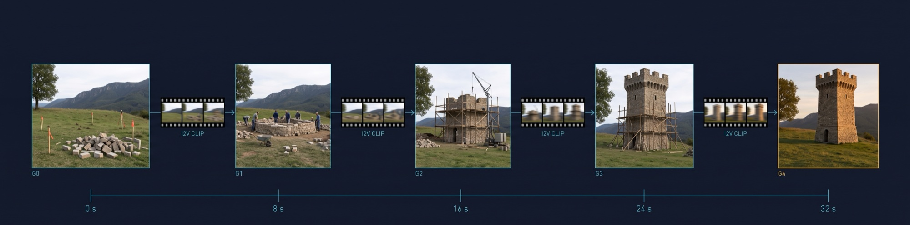

```
photo G0 ─ clip 0 ─ photo G1 ─ clip 1 ─ photo G2 ─ … ─ clip N−1 ─ photo GN (master frame)

N scenes  →  N+1 images  ·  N image-to-video clips  ·  0 text-to-video  =  2N+1 prompts
```

- **Every clip is locked at both ends.** The photo on its left is its first frame; the photo on its right is its last
  frame. The seam between two clips is _the same image_, so light, shadow, dust and structure cannot jump at a cut.
- **Production runs backwards.** The finished master frame (GN) is generated first; then image-to-image walks back to
  G0 (GN → GN−1 → … → G0). A finished building is easier to keep identical than an empty site.
- **Every step has a gate.** `zincir_kontrol.sh` compares each new frame with the last approved one and with the master
  frame: SSIM on the left/right edge strips and the bottom band (where the fixed anchors live), and the pixel drift limit
  for three landmarks checked by hand (2 px per 1080 px). A frame that fails is thrown away and re-derived from the last
  approved one.
- **No text-to-video fallback.** A clip from text cannot be locked to two frames. If a clip fails, it is re-run from the
  same two frames.

Why: in the measured archive, continuity failed in five films out of five, and every time the cause was the seam.

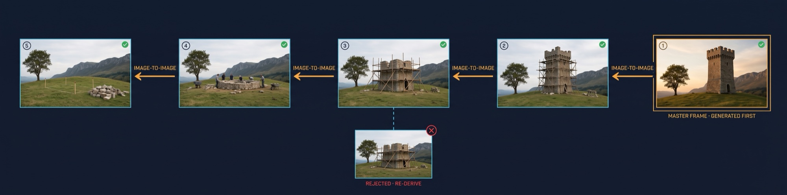

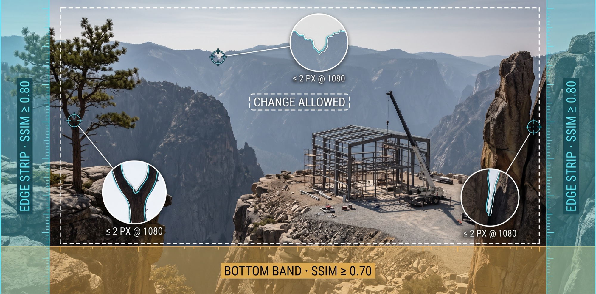

## 4. Formats

| line                 | folder                 | grid                                                                                                                                                                      | runtime                                               | prompts               |
| -------------------- | ---------------------- | ------------------------------------------------------------------------------------------------------------------------------------------------------------------------- | ----------------------------------------------------- | --------------------- |
| 📱 Vertical 9:16     | `dikey_shorts/`        | **exactly 7 scenes × 8.0 s** (owner exceptions: THE POOL ROOM · THE RAIN TOWER · TOTAL RESET · FIRST SLICE · THE HIDDEN LOFT · THE LAST STOP · THE SKY VAULT · GAME ON · UNDERWATER OBSERVATORY · COLOSSUS · THE TURNTABLE · LIT AGAIN 8) | 56.0 s, shared at 2× (≈28 s) **+ closing cover card** | 8 images + 7 I2V = 15 |
| 🖥️ Horizontal 2 min  | `yatay_2_dk_filmler/`  | band 12 × 10.0 s · owner-approved 15 / 18 / 20 × 8.0 s                                                                                                                    | 2:00 – 2:40                                           | 2N+1                  |
| 🖥️ Horizontal 4 min  | `yatay_4_dk_filmler/`  | band 24 × 10.0 s · owner-approved 30 × 8.0 s                                                                                                                              | 4:00                                                  | 2N+1                  |
| 🖥️ Horizontal 6 min  | `yatay_6_dk_filmler/`  | 36 × 10.0 s (two QA halves)                                                                                                                                               | 6:00                                                  | 73                    |
| 🖥️ Horizontal 8 min  | `yatay_8_dk_filmler/`  | 48 × 10.0 s (two QA halves)                                                                                                                                               | 8:00                                                  | 97                    |
| 🖥️ Horizontal 12 min | `yatay_12_dk_filmler/` | 90 × 8.0 s (three parts, QA per part)                                                                                                                                     | 12:00                                                 | 181                   |

The 6- and 8-minute ladders are open but have no films yet; the 12-minute ladder holds THE SKY STATION and THE GRAND REVIVAL. Since 16.10.2026
every film ends with its cover as a closing title card (owner rule), declared in the plan and laid out with
`DIKEY_TIMELAPSE_KAPAK_KILAVUZU` for vertical films. Horizontal films are 1920×1080 at 30 fps and are split into
two part files with the part boundary on a shared frame, never on a cut.

The camera is not chosen by eye: position, lens, tilt and the pixel position of every anchor are calculated in the plan
(`KAMERA_ISTASYONU_KILAVUZU` · `KAMERA_DILI_KILAVUZU`).

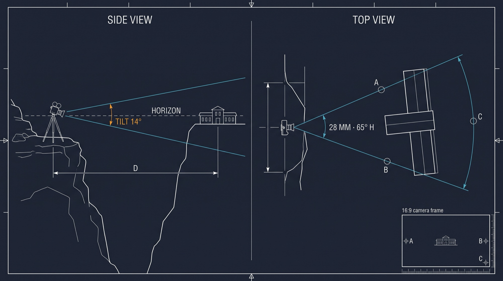

## 5. Pipeline

```mermaid
flowchart LR
  A[Story proposal<br/>in chat] -->|owner approves| B[film_klasoru_ac.sh<br/>opens folder]
  B --> C[00_ANALIZ<br/>lessons · concept · risks<br/>scene table]
  C --> D[PLAN<br/>invariants · stage ladder<br/>frame table · ledgers]
  D --> E[Master frame GN<br/>+ part prompts]
  E --> F{prompt_kontrol.py}
  F -->|BLOCK| E
  F -->|GO / declared FIX| G[Tool gate<br/>8 measurements]
  G --> H[Pilot trio]
  H --> I[Reverse chain<br/>GN → G0<br/>zincir_kontrol.sh]
  I --> J[I2V clips<br/>between approved frames]
  J --> K[Edit · kesme_kontrol<br/>ihrac_kontrol]
  K --> L[qa_paket.sh<br/>5 lenses]
  L -->|killer verdict| I
  L --> M[Release package<br/>YouTube · IG · TikTok]
```

## 6. Repository map

```
timelapse_md/
├── AGENTS.md                 ⭐ agent contract: task cards, "which event changes which files"
├── CLAUDE.md                 pointer to AGENTS.md + "only the owner commits"
├── LICENSE · .gitignore       MIT · local junk, Python cache and video files stay out
├── images/                   README images (prompts at the end of this file)
├── kilavuzlar/               ⭐ THE BRAIN — 36 guides
│   ├── KILAVUZ_REHBERI.md    ⭐ start here: decision tree · format card · invariants · stage ladder
│   │                            · sun clock · concept gate · negative core · production flow
│   ├── DERSLER.md            94 measured lessons (film · scene · second · what broke)
│   ├── VARSAYIMLAR.md        unmeasured assumptions with status (open / measured / dropped)
│   ├── PLAN_OKUMALARI.md     expert readings and plan decisions with status
│   ├── PROMPT_SABLONU.md     image + two-ended I2V skeleton
│   ├── KAMERA_*.md           camera station, framing maths, camera language, camera moves
│   ├── ISTASYON_VE_IC_MEKAN  second fixed camera / interior shots
│   ├── INSAAT_YONTEMI · SANTIYE_HAREKETI · FIZIK_VE_AGIRLIK · MALZEME_VE_DOKU
│   ├── HAVA_VE_ATMOSFER · ZAMAN_VE_ISIK · ISIK_FINALI · SU_VE_YANSIMA · PERSPEKTIF_VE_OLCEK
│   ├── UZUN_FORM_ANLATI      long-form story: curiosity chain for 2–8 minute films
│   ├── QA_*.md · RUBRIK_YAZIM QA runs, measured facts, rubric writing, calibration, records
│   ├── MUZIK_VE_KAPAK · KURGU_VE_TESLIM · ONARIM_VE_YENIDEN_URETIM
│   ├── DIKEY_TIMELAPSE_KAPAK vertical cover: 780×840 core · title box · 3:4/4:5/1:1 crop proofs
│   └── FILM_KLASOR_SABLONU/  copyable skeleton of a horizontal film folder
├── dikey_shorts/             📱 41 vertical films (one folder each)
├── yatay_2_dk_filmler/       🖥️ 10 horizontal 2-minute films
├── yatay_4_dk_filmler/       🖥️ 2 horizontal 4-minute films
├── yatay_6_dk_filmler/       🖥️ open, empty
├── yatay_8_dk_filmler/       🖥️ open, empty
├── yatay_12_dk_filmler/      🖥️ 1 horizontal 12-minute film (three parts)
├── QA/                       🔍 five lenses · TABLO.md (the only QA counter) · HAM/ (raw, untouchable) · FILMLER/
│   └── ARSIV_12_MERCEK/      🗄️ frozen 12-lens archive: 393 raw reports, audit map, cross-analysis
├── arastirma/                🔬 35 self-contained research prompts + SONUCLAR/ (raw reports and audits)
├── apexait/                  📺 channel layer: identity, release plan, cross-posting, platform templates
└── araclar/                  🛠️ gates and counters (Bash + Python)
```

## 7. Anatomy of a horizontal film folder

```
yatay_2_dk_filmler/THE_LAST_CARRIAGE/
├── 00_ANALIZ/
│   ├── 00_HIKAYE_ONAYI.md         owner's approval, scene by scene, with every deviation listed
│   ├── 00_OKUMA_CIZELGESI.md      which guides were read (generated by the folder script)
│   ├── 01_QA_DERS_HASADI.md       which measured lessons apply to this film
│   ├── 02_KONSEPT_VE_RISK.md      promise / resistance / cost · camera maths · risks
│   ├── 03_SAHNE_SIRALAMASI.md     build order → N rows · seam audit · light-day sum
│   ├── 04_UYARI_NOTLARI.md        each risk tied to a measured failure and a fix
│   └── 05_SAHNE_CALISMALARI/      scene table (five questions per clip) + generator script
├── THE_LAST_CARRIAGE_PLAN.md       invariants · stage ladder · frame table · ledgers  ⛔ no prompts
├── THE_LAST_CARRIAGE_BOLUM_1.md    scene blocks, first half (image + I2V prompts)
├── THE_LAST_CARRIAGE_BOLUM_2.md    second half + 🌟 master frame (GN)
├── THE_LAST_CARRIAGE_KAPAK.md      cover, derived from the master frame
├── THE_LAST_CARRIAGE_MUZIK.md      music / sound table
├── THE_LAST_CARRIAGE_YAYIN_PAKETI.md  English release copy (title, description, pinned comment)
├── THE_LAST_CARRIAGE_QA_SPEC.md    lock list + final-frame evidence line
└── THE_LAST_CARRIAGE_URETIM_GUNLUGU.md production log, one row per clip
```

A vertical film is lighter: `<FILM>_DIKEY_TIMELAPSE.md` (plan + prompts + music + package), `_QA_SPEC.md`, `_KAPAK.md`
and a production log.

## 8. Tools (`araclar/`)

| tool                 | when                  | what it does                                                                                                                                                             |
| -------------------- | --------------------- | ------------------------------------------------------------------------------------------------------------------------------------------------------------------------ |
| `sayac.sh`           | any time              | computes every count in the repo from the file system and runs the prompt gate on all plans                                                                              |
| `film_klasoru_ac.sh` | new horizontal film   | copies the folder skeleton, stamps scene rows, builds the reading checklist                                                                                              |
| `prompt_kontrol.py`  | **before production** | text gate: block labels, both I2V end sentences, banned words, temporary gear in invariants, hands at work, prompt length, scene grid… exit `0` GO · `1` FIX · `2` BLOCK |
| `zincir_kontrol.sh`  | **between frames**    | edge-strip and bottom-band SSIM vs. the last approved frame and the master frame + px drift limit for three hand-checked landmarks; exit `2` = chain broken              |
| `kare_al.sh`         | QA                    | first / middle / last frame grabs per clip + seam pairs                                                                                                                  |
| `kesme_kontrol.sh`   | before release        | top-N cut detection: does the edit follow the plan's duration column?                                                                                                    |
| `ihrac_kontrol.sh`   | before sharing        | runtime / speed, end card, final hold (SSIM), music and text checklist                                                                                                   |
| `qa_paket.sh`        | QA                    | builds five lens packages with measured facts inside the rubric; stops if there is no production log                                                                     |
| `klip_eslestir.py`   | before export         | finds every produced clip inside the published file (full · trimmed · missing), checks order and the tail after the last clip against the declared cover card            |
| `kapak_prova.py`     | before release        | vertical cover proofs: canvas check, centred 3:4 / 4:5 / 1:1 crops, 140 px thumbnails, safe-area overlay, one proof board                                                |
| `capraz_sayim.py`    | archive               | recomputes the cross-analysis score matrix                                                                                                                               |

Requirements: `bash`, `python3` (standard library; `klip_eslestir.py` needs numpy, `kapak_prova.py` needs Pillow), `ffmpeg` / `ffprobe` for the video tools. Developed on macOS.

<table>
<tr>
<td width="50%">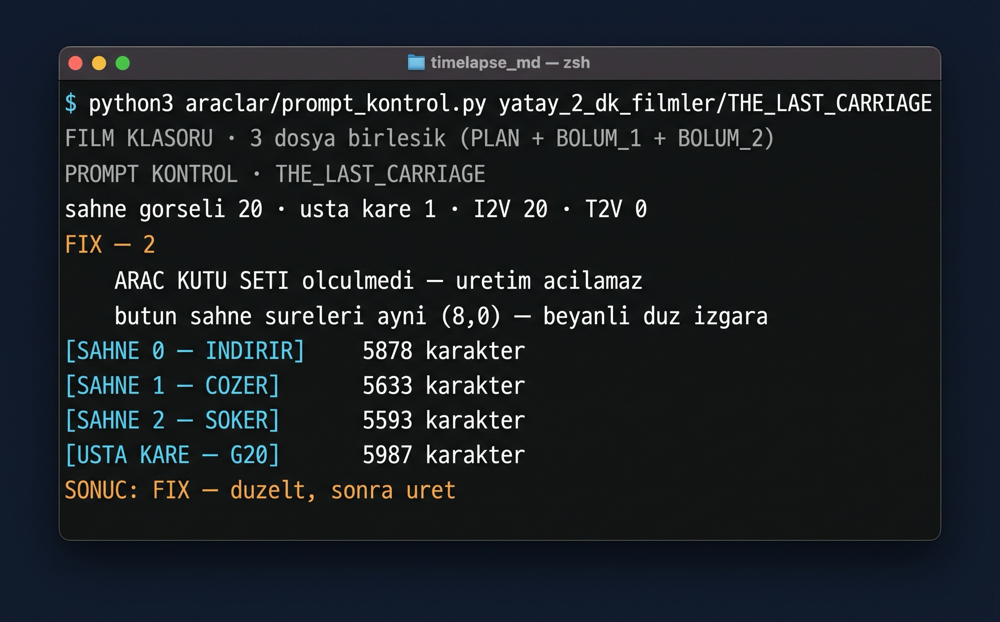</td>
<td width="50%">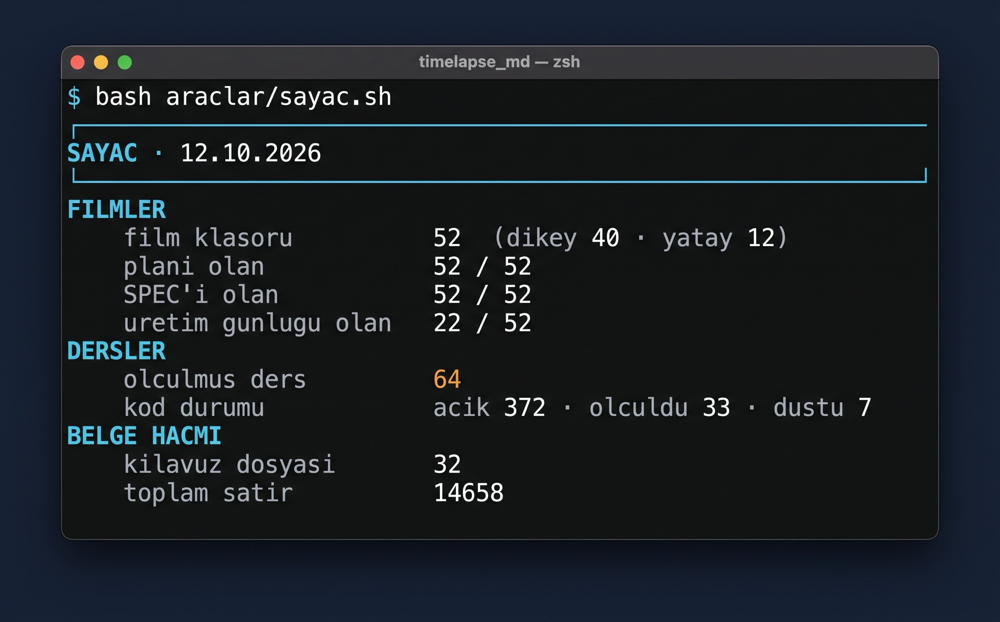</td>
</tr>
</table>

## 9. Quality assurance — five lenses

|     lens     | the one question                                                      |   mode    | killer verdict          |
| :----------: | --------------------------------------------------------------------- | :-------: | ----------------------- |
|   ❶ IMAGE    | One camera, one timelapse, solid image?                               |   blind   | SEPARATE IMAGES         |
| ❷ TIME & CUT | Does time run one way at one speed; does a cut mean "time"?           |   blind   | —                       |
|    ❸ SITE    | Same world at every cut; is the site always working?                  |   blind   | REBUILT                 |
|   ❹ BUILD    | Is it the spec's structure, built piece by piece by visible hands?    | with docs | DIFFERENT               |
|  ❺ DELIVERY  | Did the promise reach the screen; does the film _end_ or just _stop_? | with docs | (STOPS → re-production) |

- Blind lenses never see the plan; each lens runs in its own temporary chat.
- Machines measure durations, cuts and drift; the model only judges. A verdict line beats the score average.
- Raw reports are stored untouched in `QA/HAM/`; every number in `QA/TABLO.md` links to a raw file.
- The previous 12-lens system was audited and frozen on 06.10.2026: of 393 raw reports, 189 were complete, and half of
  the runs that needed documents were run without them. That audit is why the system was rebuilt.
- First vertical film on the five lenses — THE POOL ROOM (16.10.2026): the lenses gave up to 10/10, three of five missed
  the closing card and two quoted the spec's pixel numbers (leak). Agent measurement (ffprobe, clip matching, frame
  boards) found the dropped clip, the off-plan end frame and the front-loaded clips. Since then the agent checks every
  raw report against a 1-second frame board before it is recorded (check D6, lesson 90).

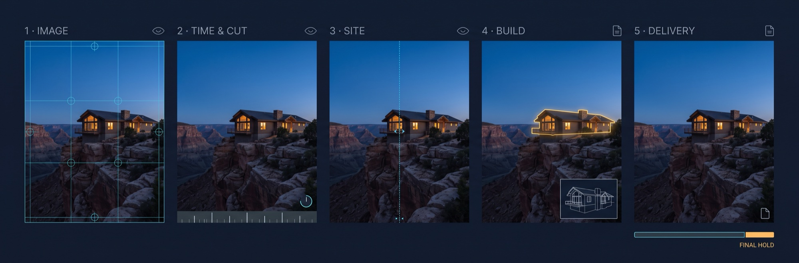

## 10. Lessons, assumptions and research

| kind                                    | file                           | can it create a rule?                                                             |
| --------------------------------------- | ------------------------------ | --------------------------------------------------------------------------------- |
| **Lesson** (`DERS n`)                   | `kilavuzlar/DERSLER.md`        | ✅ yes: a measured failure (film · scene · second), with what the rule takes away |
| **Assumption** (`D` · `A` · `F1` · `C`) | `kilavuzlar/VARSAYIMLAR.md`    | ⚠️ only as a reasoned default, status ⬜ until measured                           |
| **Plan reading** (`P`)                  | `kilavuzlar/PLAN_OKUMALARI.md` | ⚠️ same                                                                           |
| **Research finding**                    | `arastirma/SONUCLAR/`          | ❌ never directly: raw reports are audited first                                  |

Research audits in `arastirma/SONUCLAR/*_DENETIM.md` found re-computed numbers that did not hold, ffmpeg commands that did
not run, and sources that existed but did not support the claim. That is why no number goes straight from a report into a
guide.

## 11. Quick start

```bash
git clone git@github.com:Burak1320demiroz/timelapse_md.git
cd timelapse_md

bash araclar/sayac.sh                                              # real state of the repo
python3 araclar/prompt_kontrol.py yatay_2_dk_filmler/THE_SKY_CANAL # gate one horizontal film (folder mode)
python3 araclar/prompt_kontrol.py dikey_shorts/THE_EMPTY_RIDGE/THE_EMPTY_RIDGE_DIKEY_TIMELAPSE.md
bash araclar/zincir_kontrol.sh G12.png G11.png G20.png             # drift between frames (3rd arg = master)
```

Writing a new film? Read in this order: `AGENTS.md` (card A or Y2) → `kilavuzlar/KILAVUZ_REHBERI.md` → the format folder's
`README.md`. A story is proposed scene by scene and approved by the owner **before** any file is written.

## 12. Honest status

- **No plan passes the current gate with GO.** 20 plans are at FIX (8 horizontal + THE POOL ROOM + THE RAIN TOWER + TOTAL RESET + FIRST SLICE + THE HIDDEN LOFT + THE LAST STOP + THE SKY VAULT + GAME ON + UNDERWATER OBSERVATORY + COLOSSUS + THE TURNTABLE + LIT AGAIN, declared warnings); 44
  are BLOCK, most of them vertical films written before the gate was tightened on 05.10.2026 and kept as archive.
  THE SKY STATION (12 min) has its plan only; part files and spec are not written yet. THE GRAND REVIVAL (12 min, nine
  fixed cameras by owner exception) passes the gate on its combined file with 0 BLOCK · 4 declared FIX; the folder-mode
  gate does not know the 12-minute room files yet.
- **The five-lens QA has measured 4 films** (THE SKY STATION part 1, THE POOL ROOM, THE RAIN TOWER, THE HIDDEN LOFT). No score is
  trustworthy on its own: POOL ROOM's only complete run gave 10/10 while the machine found three plan mismatches; RAIN TOWER's blind
  lenses were run with the spec attached or without the measured facts block (lesson 100); in HIDDEN LOFT two lenses run without the
  block invented 32 one-second clips and scored almost every category 10/10 (lesson 105).
- **Targets the frame cannot see get redrawn where it can.** RAIN TOWER's pit sat behind a sill, invisible at tilt 0; the
  model opened a pit in the yard and sprayed the water onto it, then erased both (lesson 95). The final waterfall held.
- **The model front-loads the work.** In 6 of 7 POOL ROOM clips the main change finished in the first 2–4 s of 8; the
  per-second schedules in the prompts did not hold, the late deliveries did (lesson 92).
- **The gate checks text, not meaning.** In a measured run, 15 plans passed the gate and most still failed the build lens.
- **The reverse chain is the least tested step.** It has the highest leverage and the fewest runs with a production log.
- Most assumptions are still open. They become lessons after production, or they are dropped.

## 13. Principles

1. A number lives in one place.
2. No film is written without reading the guides; no production without the prompt gate.
3. Production runs backwards: master frame first.
4. Every new ban says which storytelling it removes.
5. **No real project, company, place or logo claims.** Every video carries a reality statement and the platform's
   "altered / synthetic content" flag.
6. Prompts are English and positive (measurable anchors); documents are Turkish.
7. Only the project owner commits and pushes. Agents leave work ready to commit.

## 14. Contributing

Issues and discussions are welcome. Before opening a pull request, run `bash araclar/sayac.sh` and the gate on any film you
touched. New lessons must name the film, scene, second and what broke; new guide files are opened only if they carry a
lesson. See `AGENTS.md` for the full task cards.

## 15. License

**MIT** — see [`LICENSE`](LICENSE). It covers the whole repository: tools, guides, film plans, prompts and images.
The films and structures are fictional; the reality statement in §13 still applies to anything you publish with them.

Sister repository: `film_md` (vertical space/sci-fi shorts). This repo inherited its skeleton and deliberately reversed some
of its rules (`KILAVUZ_REHBERI §1.2`).

---

# 🇹🇷 Türkçe

## 1. Bu nedir?

`timelapse_md` bir **video deposu değildir.** Bir yapay zekâ timelapse stüdyosunun _kâğıt tarafının_ tamamıdır: her film
burada Markdown olarak planlanır, promptlanır, kapıdan geçirilir, günlüğe yazılır ve denetlenir. Tek bir kare üretilmeden
önce küçük Bash/Python araçlarıyla kontrol edilir.

Her film, **tek bir sabit kameradan**, kurgusal bir yapının yapılışını ya da onarılışını gösterir: boş bir sırtta rüzgâr
türbini, uçurum restoranına dönüşen paslı bir vagon, orman çukurunda su basmış bir tiyatro. Görseller ve klipler harici
image-to-image ve image-to-video (I2V) modelleriyle üretilir. Bu depo o modellerden **ne istendiğine**, **hangi sırayla**
istendiğine ve sonucun **nasıl yargılandığına** karar verir.

```
HİKÂYE ONAYI → ANALİZ → PLAN → USTA KARE → PROMPTLAR → PROMPT KAPISI → ARAÇ KAPISI → PİLOTLAR
      → TERS KEYFRAME ZİNCİRİ → I2V KLİPLERİ → KURGU → KESME / İHRAÇ KONTROLÜ → 5 MERCEKLİ QA → YAYIN
```

Sistemin tek disiplini: **ders, ölçülmüş bir bozulmadır.** Kılavuzlardaki her kural bir filme, bir sahneye ve bir şeyin
kırıldığı saniyeye işaret eder. Ölçülmemiş fikirler ayrı tutulur: _varsayım_ olarak, açık/kapalı durumuyla.

## 2. Bir bakışta

|                                           |                                           sayı | kaynak                                              |
| ----------------------------------------- | ---------------------------------------------: | --------------------------------------------------- |
| 🎬 Film klasörü                           |                   **62** (48 dikey · 14 yatay) | `dikey_shorts/` · `yatay_*_dk_filmler/`             |
| 📄 Planı / QA SPEC'i olan                 |                              62 / 62 · 61 / 62 | `sayac.sh` (THE SKY STATION SPEC'i henüz yazılmadı) |
| 📓 Üretim günlüğü olan                    |                                        31 / 62 | `sayac.sh` (günlüksüz filme QA açılmaz)             |
| ⛓️ İki keyframe zincirindeki plan         |                                        56 / 62 | `KILAVUZ_REHBERI §2.7`                              |
| 📚 Ölçülmüş ders                          |                                        **100** | `kilavuzlar/DERSLER.md`                             |
| 🧪 Kodlu varsayım ve plan okuması         | 444 (⬜ açık 404 · ✅ ölçüldü 33 · ❌ düştü 7) | `VARSAYIMLAR.md` · `PLAN_OKUMALARI.md`              |
| 🔬 Araştırma promptu / işlenmiş ham rapor |                                        35 / 49 | `arastirma/`                                        |
| 📘 Kılavuz dosyası                        |                             36 (≈17.600 satır) | `kilavuzlar/`                                       |
| 🔍 QA merceği (güncel sistem)             |              5 · 3 film ölçüldü (15 ham rapor) | `QA/Q1…Q5` · `QA/TABLO.md`                          |
| 🗄️ Arşivlenmiş QA ham raporu (12 mercek)  |    **393** ham rapor · 37 film · 31 film kaydı | `QA/ARSIV_12_MERCEK/`                               |
| 🛠️ Araç                                   |                        11 betik (≈2.400 satır) | `araclar/`                                          |
| 📝 Depodaki Markdown                      |                    ≈980 dosya · ≈171.000 satır | —                                                   |

## 3. Ana fikir: iki keyframe zinciri


```
foto G0 ─ klip 0 ─ foto G1 ─ klip 1 ─ foto G2 ─ … ─ klip N−1 ─ foto GN (usta kare)

N sahne  →  N+1 görsel  ·  N image-to-video klibi  ·  0 text-to-video  =  2N+1 prompt
```

- **Her klip iki ucundan kilitlidir.** Solundaki foto ilk karesi, sağındaki foto son karesidir. İki klip arasındaki dikiş
  _aynı görseldir_; kesmede ışık, gölge, toz ve yapı atlayamaz.
- **Üretim tersten yürür.** Önce bitmiş usta kare (GN) üretilir, sonra image-to-image ile G0'a doğru geri gidilir
  (GN → GN−1 → … → G0). Bitmiş bir yapıyı aynı tutmak boş bir şantiyeyi aynı tutmaktan kolaydır.
- **Her adımın kapısı var.** `zincir_kontrol.sh` her yeni kareyi son onaylı kareyle ve usta kareyle karşılaştırır: sabit
  çapaların durduğu sol/sağ kenar şeritlerinde ve alt bantta SSIM ölçer, elle bakılacak üç nirengi için piksel kayma
  sınırını basar (1080 px'te 2 px). Geçemeyen kare atılır, son onaylı kareden yeniden türetilir.
- **Text-to-video yedeği yok.** Metinden üretilen klip iki kareye kilitlenemez. Klip tutmazsa aynı iki kareden yeniden koşulur.

Neden: ölçülmüş arşivde devamlılık beş filmin beşinde de düştü ve her seferinde sebep dikişti.


## 4. Formatlar

| hat            | klasör                 | ızgara                                                                                                                                                                   | süre                                                    | prompt                |
| -------------- | ---------------------- | ------------------------------------------------------------------------------------------------------------------------------------------------------------------------ | ------------------------------------------------------- | --------------------- |
| 📱 Dikey 9:16  | `dikey_shorts/`        | **kesin 7 sahne × 8,0 sn** (sahip istisnaları: THE POOL ROOM · THE RAIN TOWER · TOTAL RESET · FIRST SLICE · THE HIDDEN LOFT · THE LAST STOP · THE SKY VAULT · GAME ON · UNDERWATER OBSERVATORY · COLOSSUS · THE TURNTABLE · LIT AGAIN 8) | 56,0 sn, 2x paylaşılır (≈28 sn) **+ sonda kapak kartı** | 8 görsel + 7 I2V = 15 |
| 🖥️ Yatay 2 dk  | `yatay_2_dk_filmler/`  | bant 12 × 10,0 sn · sahip izniyle 15 / 18 / 20 × 8,0 sn                                                                                                                  | 2:00 – 2:40                                             | 2N+1                  |
| 🖥️ Yatay 4 dk  | `yatay_4_dk_filmler/`  | bant 24 × 10,0 sn · sahip izniyle 30 × 8,0 sn                                                                                                                            | 4:00                                                    | 2N+1                  |
| 🖥️ Yatay 6 dk  | `yatay_6_dk_filmler/`  | 36 × 10,0 sn (QA iki yarıda)                                                                                                                                             | 6:00                                                    | 73                    |
| 🖥️ Yatay 8 dk  | `yatay_8_dk_filmler/`  | 48 × 10,0 sn (QA iki yarıda)                                                                                                                                             | 8:00                                                    | 97                    |
| 🖥️ Yatay 12 dk | `yatay_12_dk_filmler/` | 90 × 8,0 sn (üç bölüm, QA bölüm başına)                                                                                                                                  | 12:00                                                   | 181                   |

6 ve 8 dakikalık klasörler açık ama henüz filmleri yok; 12 dakikalık basamakta THE SKY STATION ve THE GRAND REVIVAL var. 16.10.2026'dan beri
her film kapağıyla, sonda başlıklı kart olarak biter (sahip kuralı); kart planda beyan edilir, dikeyde yerleşim
`DIKEY_TIMELAPSE_KAPAK_KILAVUZU`'ndan okunur. Yatay filmler 1920×1080 · 30 fps'dir ve iki bölüm dosyasına
ayrılır; bölüm sınırı bir kesme değil, ortak bir karedir.

Kamera gözle seçilmez: konum, lens, tilt ve her çapanın piksel konumu planda hesaplanır
(`KAMERA_ISTASYONU_KILAVUZU` · `KAMERA_DILI_KILAVUZU`).


## 5. Akış

```mermaid
flowchart LR
  A[Hikâye önerisi<br/>sohbette] -->|sahip onaylar| B[film_klasoru_ac.sh<br/>klasörü açar]
  B --> C[00_ANALIZ<br/>dersler · konsept · risk<br/>sahne tablosu]
  C --> D[PLAN<br/>değişmezler · merdiven<br/>kare tablosu · defterler]
  D --> E[Usta kare GN<br/>+ bölüm promptları]
  E --> F{prompt_kontrol.py}
  F -->|BLOCK| E
  F -->|GO / beyanlı FIX| G[Araç kapısı<br/>8 ölçüm]
  G --> H[Pilot üçlü]
  H --> I[Ters zincir<br/>GN → G0<br/>zincir_kontrol.sh]
  I --> J[I2V klipleri<br/>onaylı kareler arasında]
  J --> K[Kurgu · kesme_kontrol<br/>ihrac_kontrol]
  K --> L[qa_paket.sh<br/>5 mercek]
  L -->|öldürücü hüküm| I
  L --> M[Yayın paketi<br/>YouTube · IG · TikTok]
```

## 6. Depo haritası

```
timelapse_md/
├── AGENTS.md                 ⭐ ajan kontratı: görev kartları, "hangi olay hangi dosyayı değiştirir"
├── CLAUDE.md                 AGENTS.md'ye işaret + "commit'i yalnız sahip atar"
├── LICENSE · .gitignore       MIT · yerel çöp, Python önbelleği ve video dosyaları dışarıda
├── images/                   README görselleri (promptlar bu dosyanın sonunda)
├── kilavuzlar/               ⭐ SİSTEMİN BEYNİ: 36 kılavuz
│   ├── KILAVUZ_REHBERI.md    ⭐ buradan başla: karar ağacı · format kartı · değişmezler · aşama merdiveni
│   │                            · güneş saati · konsept kapısı · negatif çekirdek · üretim akışı
│   ├── DERSLER.md            94 ölçülmüş ders (film · sahne · saniye · ne kırıldı)
│   ├── VARSAYIMLAR.md        ölçülmemiş varsayımlar, durum sütunuyla (açık / ölçüldü / düştü)
│   ├── PLAN_OKUMALARI.md     uzman okumaları ve plan kararları, durum sütunuyla
│   ├── PROMPT_SABLONU.md     görsel + iki uçlu I2V iskeleti
│   ├── KAMERA_*.md           kamera istasyonu, kadraj hesabı, kamera dili, kamera hareketi
│   ├── ISTASYON_VE_IC_MEKAN  ikinci sabit kamera / iç mekân planları
│   ├── INSAAT_YONTEMI · SANTIYE_HAREKETI · FIZIK_VE_AGIRLIK · MALZEME_VE_DOKU
│   ├── HAVA_VE_ATMOSFER · ZAMAN_VE_ISIK · ISIK_FINALI · SU_VE_YANSIMA · PERSPEKTIF_VE_OLCEK
│   ├── UZUN_FORM_ANLATI      uzun form anlatı: 2–8 dk filmler için merak zinciri
│   ├── QA_*.md · RUBRIK_YAZIM QA koşusu, ölçülmüş olgular, rubrik yazımı, kalibrasyon, kayıt
│   ├── MUZIK_VE_KAPAK · KURGU_VE_TESLIM · ONARIM_VE_YENIDEN_URETIM
│   ├── DIKEY_TIMELAPSE_KAPAK dikey kapak: 780×840 çekirdek · başlık kutusu · 3:4/4:5/1:1 kırpma provası
│   └── FILM_KLASOR_SABLONU/  yatay film klasörünün kopyalanabilir iskeleti
├── dikey_shorts/             📱 41 dikey film (her biri bir klasör)
├── yatay_2_dk_filmler/       🖥️ 10 yatay 2 dakikalık film
├── yatay_4_dk_filmler/       🖥️ 2 yatay 4 dakikalık film
├── yatay_6_dk_filmler/       🖥️ açık, boş
├── yatay_8_dk_filmler/       🖥️ açık, boş
├── yatay_12_dk_filmler/      🖥️ 1 yatay 12 dakikalık film (üç bölüm)
├── QA/                       🔍 beş mercek · TABLO.md (QA'nın tek sayacı) · HAM/ (ham, dokunulmaz) · FILMLER/
│   └── ARSIV_12_MERCEK/      🗄️ dondurulmuş 12 mercekli arşiv: 393 ham rapor, eşleme tablosu, çapraz analiz
├── arastirma/                🔬 kendi kendine yeten 35 araştırma promptu + SONUCLAR/ (ham raporlar ve denetimler)
├── apexait/                  📺 kanal katmanı: kimlik, yayın planı, çapraz yayın, platform şablonları
└── araclar/                  🛠️ kapılar ve sayaçlar (Bash + Python)
```

## 7. Bir yatay film klasörünün anatomisi

```
yatay_2_dk_filmler/THE_LAST_CARRIAGE/
├── 00_ANALIZ/
│   ├── 00_HIKAYE_ONAYI.md         sahibin sahne sahne onayı, her sapma listeli
│   ├── 00_OKUMA_CIZELGESI.md      hangi kılavuzlar okundu (klasör betiği üretir)
│   ├── 01_QA_DERS_HASADI.md       bu filme hangi ölçülmüş dersler uygulanıyor
│   ├── 02_KONSEPT_VE_RISK.md      vaat / direnç / bedel · kamera hesabı · riskler
│   ├── 03_SAHNE_SIRALAMASI.md     inşa sırası → N satır · dikiş denetimi · ışık günü toplamı
│   ├── 04_UYARI_NOTLARI.md        her risk ölçülmüş bir arızaya ve bir çözüme bağlı
│   └── 05_SAHNE_CALISMALARI/      sahne tablosu (klip başına beş soru) + üretici betik
├── THE_LAST_CARRIAGE_PLAN.md       değişmezler · aşama merdiveni · kare tablosu · defterler  ⛔ prompt yok
├── THE_LAST_CARRIAGE_BOLUM_1.md    sahne blokları, ilk yarı (görsel + I2V promptları)
├── THE_LAST_CARRIAGE_BOLUM_2.md    ikinci yarı + 🌟 usta kare (GN)
├── THE_LAST_CARRIAGE_KAPAK.md      usta kareden türeyen kapak
├── THE_LAST_CARRIAGE_MUZIK.md      müzik / ses tablosu
├── THE_LAST_CARRIAGE_YAYIN_PAKETI.md  İngilizce yayın metni (başlık, açıklama, sabit yorum)
├── THE_LAST_CARRIAGE_QA_SPEC.md    kilit listesi + final kare kanıtı satırı
└── THE_LAST_CARRIAGE_URETIM_GUNLUGU.md üretim günlüğü, klip başına bir satır
```

Dikey film daha hafiftir: `<FILM>_DIKEY_TIMELAPSE.md` (plan + promptlar + müzik + paket), `_QA_SPEC.md`, `_KAPAK.md` ve
üretim günlüğü.

## 8. Araçlar (`araclar/`)

| araç                 | ne zaman             | ne yapar                                                                                                                                                                                      |
| -------------------- | -------------------- | --------------------------------------------------------------------------------------------------------------------------------------------------------------------------------------------- |
| `sayac.sh`           | her zaman            | depodaki bütün sayıları dosya sisteminden hesaplar, bütün planlarda prompt kapısını koşar                                                                                                     |
| `film_klasoru_ac.sh` | yeni yatay film      | klasör iskeletini kopyalar, sahne satırlarını damgalar, okuma çizelgesini üretir                                                                                                              |
| `prompt_kontrol.py`  | **üretimden önce**   | metin kapısı: blok etiketleri, I2V'nin iki uç cümlesi, yasak kelimeler, değişmezlerde geçici ekipman, iş başındaki eller, prompt uzunluğu, sahne ızgarası… çıkış `0` GO · `1` FIX · `2` BLOCK |
| `zincir_kontrol.sh`  | **kareler arasında** | son onaylı kareye ve usta kareye karşı kenar şeridi ve alt bant SSIM'i + elle bakılan üç nirengi için px kayma sınırı; çıkış `2` = zincir kırıldı                                             |
| `kare_al.sh`         | QA                   | klip başına ilk / orta / son kare + dikiş çiftleri                                                                                                                                            |
| `kesme_kontrol.sh`   | yayından önce        | top-N kesme tespiti: kurgu planın süre sütununa uydu mu?                                                                                                                                      |
| `ihrac_kontrol.sh`   | paylaşımdan önce     | süre / hız, son kart, final tutuşu (SSIM), müzik ve yazı listesi                                                                                                                              |
| `qa_paket.sh`        | QA                   | beş mercek paketini, ölçülmüş olgular rubriğin içinde olacak şekilde kurar; üretim günlüğü yoksa durur                                                                                        |
| `klip_eslestir.py`   | ihraçtan önce        | üretilen her klibi yayın dosyasında bulur (tam · kırpılmış · yok), sırayı ve son klipten sonraki kuyruğu beyan edilen kapak kartına karşı denetler                                            |
| `kapak_prova.py`     | yayından önce        | dikey kapak provası: tuval kontrolü, merkezden 3:4 / 4:5 / 1:1 kırpma, 140 px küçükler, güvenli alan bindirmesi, tek prova panosu                                                             |
| `capraz_sayim.py`    | arşiv                | çapraz analiz skor matrisini yeniden hesaplar                                                                                                                                                 |

Gereksinimler: `bash`, `python3` (standart kütüphane; `klip_eslestir.py` numpy, `kapak_prova.py` Pillow ister), video araçları için `ffmpeg` / `ffprobe`. macOS'ta geliştirildi.

<table>
<tr>
<td width="50%"></td>
<td width="50%"></td>
</tr>
</table>

## 9. Kalite denetimi: beş mercek

|      mercek      | tek soru                                                      |   mod   | öldürücü hüküm           |
| :--------------: | ------------------------------------------------------------- | :-----: | ------------------------ |
|    ❶ GÖRÜNTÜ     | Tek kamera, tek timelapse, görüntü katı mı?                   |   kör   | SEPARATE IMAGES          |
| ❷ ZAMAN VE KESME | Zaman tek yönde, tek hızda mı akıyor; kesme "zaman" mı demek? |   kör   | —                        |
|    ❸ ŞANTİYE     | Her kesmede aynı dünya mı; şantiye hep çalışıyor mu?          |   kör   | REBUILT                  |
|      ❹ İNŞA      | SPEC'teki yapı mı; görünen ellerle parça parça mı yapıldı?    | belgeli | DIFFERENT                |
|     ❺ TESLİM     | Vaat ekrana çıktı mı; film _bitiyor_ mu, yoksa _duruyor_ mu?  | belgeli | (STOPS → yeniden üretim) |

- Kör mercekler planı hiç görmez; her mercek kendi geçici sohbetinde koşar.
- Süreyi, kesmeyi ve kaymayı makine ölçer; model yalnız yargılar. Hüküm satırı skor ortalamasını yener.
- Ham raporlar `QA/HAM/` altında dokunulmadan saklanır; `QA/TABLO.md`'deki her sayı bir ham dosyaya bağlıdır.
- Önceki 12 mercekli sistem 06.10.2026'da denetlenip donduruldu: 393 ham raporun 189'u tamdı; belge isteyen koşuların
  yarısı belgesiz yapılmıştı. Sistem bu denetim yüzünden yeniden kuruldu.
- Beş mercekte ilk dikey film — THE POOL ROOM (16.10.2026): mercekler 10/10'a kadar verdi, beşin üçü sondaki kartı
  görmedi, ikisi SPEC'in piksel sayılarını alıntıladı (sızıntı). Ajan ölçümü (ffprobe, klip eşleştirme, kare panosu)
  düşen klibi, plan dışı bitiş karesini ve işin klip başına yığıldığını buldu. O günden beri ajan her ham raporu kayda
  geçirmeden önce 1 saniyelik kare panosuna karşı denetler (D6 kontrolü, ders 90).


## 10. Dersler, varsayımlar ve araştırma

| tür                                   | dosya                          | kural üretebilir mi?                                                         |
| ------------------------------------- | ------------------------------ | ---------------------------------------------------------------------------- |
| **Ders** (`DERS n`)                   | `kilavuzlar/DERSLER.md`        | ✅ evet: ölçülmüş bozulma (film · sahne · saniye) ve kuralın neyi kaldırdığı |
| **Varsayım** (`D` · `A` · `F1` · `C`) | `kilavuzlar/VARSAYIMLAR.md`    | ⚠️ yalnız gerekçeli varsayılan olarak, ölçülene kadar ⬜                     |
| **Plan okuması** (`P`)                | `kilavuzlar/PLAN_OKUMALARI.md` | ⚠️ aynı                                                                      |
| **Araştırma bulgusu**                 | `arastirma/SONUCLAR/`          | ❌ doğrudan asla: ham raporlar önce denetlenir                               |

`arastirma/SONUCLAR/*_DENETIM.md` denetimleri yeniden hesaplanınca tutmayan sayılar, koşmayan ffmpeg komutları ve var olan
ama iddiayı desteklemeyen kaynaklar buldu. Bu yüzden hiçbir sayı rapordan doğrudan kılavuza inmez.

## 11. Hızlı başlangıç

```bash
git clone git@github.com:Burak1320demiroz/timelapse_md.git
cd timelapse_md

bash araclar/sayac.sh                                              # deponun gerçek durumu
python3 araclar/prompt_kontrol.py yatay_2_dk_filmler/THE_SKY_CANAL # bir yatay filmi kapıdan geçir (klasör modu)
python3 araclar/prompt_kontrol.py dikey_shorts/THE_EMPTY_RIDGE/THE_EMPTY_RIDGE_DIKEY_TIMELAPSE.md
bash araclar/zincir_kontrol.sh G12.png G11.png G20.png             # kareler arası kayma (3. argüman = usta kare)
```

Yeni film mi yazacaksınız? Okuma sırası: `AGENTS.md` (kart A ya da Y2) → `kilavuzlar/KILAVUZ_REHBERI.md` → format
klasörünün `README.md`'si. Hikâye sahne sahne önerilir ve **hiçbir dosya yazılmadan önce** sahip tarafından onaylanır.

## 12. Dürüst durum

- **Hiçbir plan güncel kapıdan GO almıyor.** 20 plan FIX'te (8 yatay + THE POOL ROOM + THE RAIN TOWER + TOTAL RESET + FIRST SLICE + THE HIDDEN LOFT + THE LAST STOP + THE SKY VAULT + GAME ON + UNDERWATER OBSERVATORY + COLOSSUS + THE TURNTABLE + LIT AGAIN, beyanlı uyarılar); 44 plan BLOCK.
  Bunların çoğu kapı 05.10.2026'da sıkılaşmadan önce yazılmış ve arşiv olarak tutulan dikey filmler. THE SKY STATION
  (12 dk) yalnız planıyla duruyor; bölüm dosyaları ve SPEC henüz yazılmadı. THE GRAND REVIVAL (12 dk, sahip istisnasıyla
  dokuz sabit kamera) birleşik dosyada kapıdan 0 BLOCK · 4 beyanlı FIX ile geçiyor; klasör modu 12 dk oda dosyalarını henüz tanımıyor.
- **Beş mercekli QA 4 film ölçtü** (THE SKY STATION bölüm 1, THE POOL ROOM, THE RAIN TOWER, THE HIDDEN LOFT). Hiçbir puan tek başına
  güvenilir değil: POOL ROOM'un tek tam koşusu 10/10 verirken makine üç plan uyuşmazlığı buldu; RAIN TOWER'ın kör mercekleri SPEC ekli
  ya da ölçülmüş olgular bloğu boş koşuldu (ders 100); HIDDEN LOFT'ta blok boş koşulan iki mercek 1 sn'lik 32 klip uydurdu, kategorilerin
  hemen hepsine 10 verdi (ders 105).
- **Kadrajın göremediği hedef, görebildiği yere yeniden çizilir.** RAIN TOWER'ın çukuru eşiğin arkasındaydı, tilt 0'da görünmüyordu;
  model avluda çukur açtı, suyu oraya fışkırttı, sonra ikisini de sildi (ders 95). Final şelalesi tuttu.
- **Model işi klibin başına yığıyor.** POOL ROOM'un 7 klibinin 6'sında ana değişim 8 sn'nin ilk 2–4 sn'sinde bitti;
  promptlardaki saniye takvimi tutmadı, klip sonundaki teslimatlar tuttu (ders 92).
- **Kapı metni denetler, anlamı denetlemez.** Ölçülmüş bir koşuda 15 plan kapıdan geçti ve çoğu yine de inşa merceğinde düştü.
- **Ters zincir en az sınanmış adım.** Kaldıracı en yüksek olan ve üretim günlüğüyle en az koşulan adım bu.
- Varsayımların çoğu hâlâ açık. Üretimden sonra ya derse dönüşürler ya düşerler.

## 13. İlkeler

1. Sayı tek yerde durur.
2. Kılavuz okumadan film yazılmaz; prompt kapısından geçmeden üretim yapılmaz.
3. Üretim tersten yürür: önce usta kare.
4. Her yeni yasak, hangi anlatımı kaldırdığını yazar.
5. **Gerçek proje, firma, yer ya da logo iddiası yok.** Her videoda gerçeklik beyanı ve platformun "altered / synthetic
   content" işareti bulunur.
6. Promptlar İngilizce ve pozitiftir (ölçülebilir çapa); belgeler Türkçedir.
7. Commit ve push'u yalnız proje sahibi atar. Ajanlar işi commit'e hazır bırakır.

## 14. Katkı

Issue ve tartışmalar açıktır. Pull request açmadan önce `bash araclar/sayac.sh` ve dokunduğunuz her filmde prompt kapısını
koşun. Yeni ders film, sahne, saniye ve ne kırıldığını adıyla yazmalıdır; yeni kılavuz dosyası ancak bir ders taşıyorsa
açılır. Görev kartlarının tamamı `AGENTS.md`'de.

## 15. Lisans

**MIT** — bkz. [`LICENSE`](LICENSE). Bütün depoyu kapsar: araçlar, kılavuzlar, film planları, promptlar ve görseller.
Filmler ve yapılar kurgusaldır; bunlarla yayınladığınız her şeyde §13'teki gerçeklik beyanı yine geçerlidir.

Kardeş depo: `film_md` (uzay/bilimkurgu dikey shorts). Bu depo onun iskeletini devraldı ve bazı kurallarını bilerek tersine
çevirdi (`KILAVUZ_REHBERI §1.2`).

---

# 🎬 Film catalog / Film kataloğu

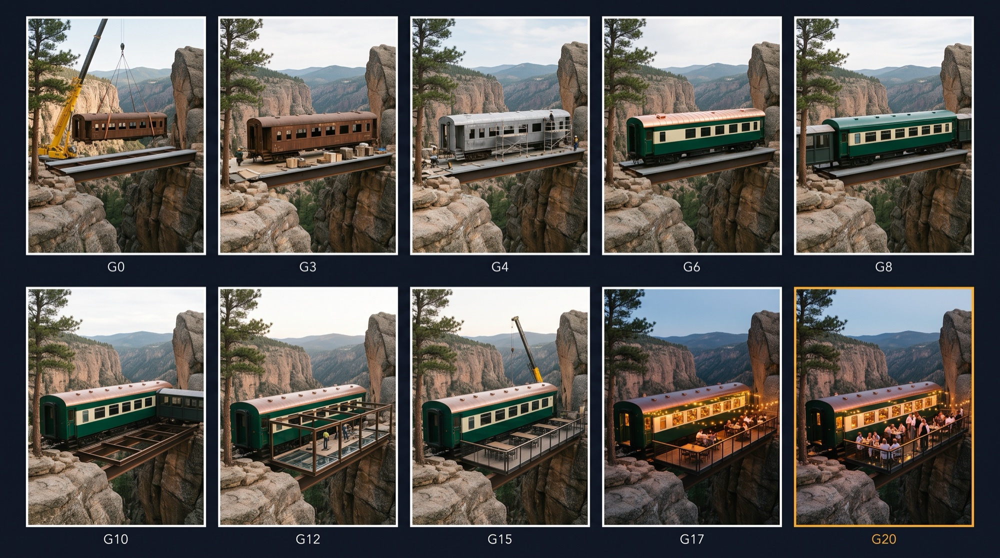

All structures and places are fictional. **Archive QA** = the film has raw reports in the frozen 12-lens archive.
Bütün yapılar ve yerler kurgusaldır. **Arşiv QA** = filmin dondurulmuş 12 mercekli arşivde ham raporları var.

### 🖥️ Horizontal / Yatay (14)

| film              | folder | grid / ızgara               | structure                                                                                                           | yapı                                                                                                                | archive QA |
| ----------------- | ------ | --------------------------- | ------------------------------------------------------------------------------------------------------------------- | ------------------------------------------------------------------------------------------------------------------- | :--------: |
| THE BURIED KHAN   | 2 dk   | 15 × 8,0 = 120 s            | stone caravanserai dug out of sand and restored                                                                     | kumdan çıkarılıp onarılan taş kervansaray                                                                           |     —      |
| THE EDEN ARK      | 2 dk   | 18 × 8,0 = 144 s            | 130 m cargo ship turned into a garden under glass                                                                   | 130 m kargo gemisi → camın altında bahçe                                                                            |     —      |
| THE FIRST LIGHT   | 2 dk   | 20 × 8,0 = 160 s            | summit observatory restored, copper dome                                                                            | zirvede onarılan gözlemevi, bakır kubbe                                                                             |     —      |
| THE GLASS WALL    | 2 dk   | 12 × 10,0 = 120 s           | steel-frame greenhouse + stone farmhouse                                                                            | çelik çerçeveli sera + taş çiftlik evi                                                                              |     ✅     |
| THE HIDDEN FALLS  | 2 dk   | 15 × 8,0 = 120 s            | glass-fronted building against a quarry wall, waterfall                                                             | ocak duvarına yaslanan cam cepheli yapı, şelale                                                                     |     —      |
| THE IRON BRIDGE   | 2 dk   | 12 × 10,0 = 120 s           | single-span steel arch footbridge                                                                                   | tek açıklıklı çelik kemer yaya köprüsü                                                                              |     ✅     |
| THE LAST CARRIAGE | 2 dk   | 20 × 8,0 = 160 s            | rusty carriage → cliffside restaurant with a glass terrace                                                          | paslı vagon → cam teraslı uçurum restoranı                                                                          |     —      |
| THE OLD ROAD      | 2 dk   | 15 × 8,0 = 120 s            | incrementally launched concrete viaduct                                                                             | itmeli beton viyadük                                                                                                |     ✅     |
| THE SKY CANAL     | 2 dk   | 20 × 8,0 = 160 s            | steel canal bridge carrying boats over a valley                                                                     | vadi üstünde tekne taşıyan çelik kanal köprüsü                                                                      |     —      |
| THE SUNKEN STAGE  | 2 dk   | 20 × 8,0 = 160 s            | flooded open-air theatre in a forest pit                                                                            | orman çukurunda su basmış açık hava tiyatrosu                                                                       |     —      |
| THE BORROWED HILL | 4 dk   | 24 × 10,0 = 240 s           | buried steel shelter on Mars                                                                                        | Mars'ta gömülü çelik kemer sığınak                                                                                  |     —      |
| THE SLOW TAKEOFF  | 4 dk   | 30 × 8,0 = 240 s            | retired jet lifted onto steel frames as a lake house                                                                | çelik çerçevelere oturtulan emekli jet, göl evi                                                                     |     —      |
| THE SKY STATION   | 12 dk  | 90 × 8,0 = 720 s            | ruined cliff cable-car station restored and running                                                                 | harabe uçurum teleferik istasyonu onarılıp çalışır                                                                  |     —      |
| THE GRAND REVIVAL | 12 dk  | 90 × 8,0 = 720 s + 5 s card | abandoned 500 m² stone villa restored room by room, nine fixed cameras (owner exception), first dinner at blue hour | terk edilmiş 500 m² taş villa oda oda yenilenir, dokuz sabit kamera (sahip istisnası), mavi saatte ilk akşam yemeği |     —      |

### 📱 Vertical / Dikey (48)

| film               | grid / ızgara | structure                                                                                                                                                                              | yapı                                                                                                                                                                   | archive QA |
| ------------------ | ------------- | -------------------------------------------------------------------------------------------------------------------------------------------------------------------------------------- | ---------------------------------------------------------------------------------------------------------------------------------------------------------------------- | :--------: |
| BACK TO PLUMB      | 7 × 8,0       | leaning brick grain tower in a farmyard                                                                                                                                                | çiftlik avlusunda yatık tuğla tahıl kulesi                                                                                                                             |     ✅     |
| BACK TO WATER      | 7 × 8,0       | steel fishing boat in a dry dock                                                                                                                                                       | kuru havuzda çelik balıkçı teknesi                                                                                                                                     |     ✅     |
| BEFORE NIGHTFALL   | 8 × 8,0       | robotic relay station near a black hole                                                                                                                                                | kara delik yakınında robotik röle istasyonu                                                                                                                            |     ✅     |
| ONE MORE TURN      | 6 × 8,0       | overshot water wheel on a stone mill                                                                                                                                                   | taş değirmende üstten beslemeli su çarkı                                                                                                                               |     ✅     |
| ORBITAL SCAFFOLD   | 10 × 8,0      | space station assembly                                                                                                                                                                 | uzay üssü montajı                                                                                                                                                      |     —      |
| OVER THE WALL      | 8 × 8,0       | roller-compacted concrete gravity dam                                                                                                                                                  | silindirle sıkıştırılmış beton ağırlık barajı                                                                                                                          |     ✅     |
| POLAR HABITAT      | 6 × 8,0       | polar habitat on an icy planet                                                                                                                                                         | buzlu gezegende kutup yaşam alanı                                                                                                                                      |     ✅     |
| THE BLUE DOOR      | 7 × 8,0       | abandoned stone shop → street café                                                                                                                                                     | terk edilmiş taş dükkân → sokak kafesi                                                                                                                                 |     ✅     |
| THE BLUE SILO      | 6 × 8,0       | harbour grain silo → seawater tank                                                                                                                                                     | liman tahıl silosu → deniz suyu tankı                                                                                                                                  |     —      |
| THE BROKEN CLIMB   | 7 × 8,0       | hillside funicular repair                                                                                                                                                              | yamaç füniküleri onarımı                                                                                                                                               |     ✅     |
| THE CLOSING SPAN   | 10 × 6,0      | cable-stayed bridge (old format)                                                                                                                                                       | kablo askılı köprü (eski format)                                                                                                                                       |     ✅     |
| THE CROSSING       | 8 scenes      | coastal cable-stayed bridge                                                                                                                                                            | kıyı kablo askılı köprü                                                                                                                                                |     ✅     |
| THE DARK ROCK      | 6 × 8,0       | granite rock lighthouse                                                                                                                                                                | granit kaya feneri                                                                                                                                                     |     ✅     |
| THE DEEP END       | 7 × 8,0       | abandoned pool → open-air cinema                                                                                                                                                       | terk edilmiş havuz → açık hava sineması                                                                                                                                |     ✅     |
| THE DEEP STEP      | 7 × 8,0       | historic stone stepwell                                                                                                                                                                | tarihi taş basamaklı su kuyusu                                                                                                                                         |     ✅     |
| THE DUST YEAR      | 10 scenes     | robotic base on Mars (old format)                                                                                                                                                      | Mars'ta robotik üs (eski format)                                                                                                                                       |     ✅     |
| THE EMPTY LOCK     | 7 × 8,0       | stone-walled canal lock                                                                                                                                                                | taş duvarlı kanal kilidi                                                                                                                                               |     ✅     |
| THE EMPTY RIDGE    | 7 × 8,0       | onshore wind turbine on an empty ridge                                                                                                                                                 | boş sırtta rüzgâr türbini                                                                                                                                              |     ✅     |
| THE FIRST GUEST    | 7 × 8,0       | human airlock on black sand                                                                                                                                                            | siyah kum üstünde insan geçiş kilidi                                                                                                                                   |     ✅     |
| THE GLASS CROSSING | 7 × 8,0       | rotten plank bridge → glass-floor walkway                                                                                                                                              | çürük kalas köprü → cam zeminli geçit                                                                                                                                  |     ✅     |
| THE HIDDEN OASIS   | 7 × 8,0       | abandoned pool → stone-edged garden pond                                                                                                                                               | terk edilmiş havuz → taş kenarlı bahçe göleti                                                                                                                          |     —      |
| THE LAST CIRCLE    | 7 × 8,0       | slip-formed grain silo                                                                                                                                                                 | kayar kalıpla dökülen tahıl silosu                                                                                                                                     |     —      |
| THE LAST FIRING    | 7 × 8,0       | hand-built field lime kiln                                                                                                                                                             | elle örülen tarla tipi kireç ocağı                                                                                                                                     |     ✅     |
| THE LAST HARBOR    | 7 × 8,0       | floating concrete caisson → harbour arm                                                                                                                                                | yüzer beton keson → liman kolu                                                                                                                                         |     ✅     |
| THE LAST LIFT      | 10 × 6,0      | oval stadium                                                                                                                                                                           | oval stadyum                                                                                                                                                           |     ✅     |
| THE LONG DAY       | 10 × 6,0      | surface base with buried habitat modules (old format)                                                                                                                                  | gömülü modüllü yüzey üssü (eski format)                                                                                                                                |     ✅     |
| THE LONG SHADOW    | —             | city-centre tower (first film, old format)                                                                                                                                             | şehir içi kule (ilk film, eski format)                                                                                                                                 |     ✅     |
| THE LONG SHADOW V2 | 7 × 8,0       | three-storey infill house in a narrow lane                                                                                                                                             | dar sokakta üç katlı dolgu ev                                                                                                                                          |     —      |
| THE MOUNTAIN CROWN | 7 × 8,0       | basalt wall → rock-cut water palace                                                                                                                                                    | bazalt duvar → kaya oyma su sarayı                                                                                                                                     |     ✅     |
| THE MOUNTAIN DOOR  | 5 × 6,0       | mountain tunnel portal (old format)                                                                                                                                                    | dağ tünel portalı (eski format)                                                                                                                                        |     ✅     |
| THE NARROW GORGE   | 7 × 8,0       | concrete arch dam in a narrow gorge                                                                                                                                                    | dar boğazda beton kemer baraj                                                                                                                                          |     —      |
| THE NARROW LOT     | 5 × 6,0       | building on a narrow city lot (old format)                                                                                                                                             | dar parselde yapı (eski format)                                                                                                                                        |     ✅     |
| THE POOL ROOM      | 8 × 8,0       | derelict indoor pool → sunken living room, old pool lamps lit again                                                                                                                    | terk edilmiş kapalı havuz → çanakta gömme salon, eski havuz lambaları yeniden yanar                                                                                    |     —      |
| THE QUIET FIELD    | 7 × 8,0       | radio telescope built from scratch                                                                                                                                                     | sıfırdan radyo teleskobu                                                                                                                                               |     ✅     |
| THE RAIN TOWER     | 8 × 8,0       | derelict freight-lift tower → planted rock wall with a recirculating waterfall                                                                                                         | terk edilmiş yük asansörü kulesi → cep cep yeşil kaya duvarı ve devridaim şelale                                                                                       |     —      |
| THE SEA MILL       | 6 × 8,0       | smock mill standing alone at sea                                                                                                                                                       | denizde tek başına duran ahşap değirmen                                                                                                                                |     —      |
| THE STAR DOCK      | 7 × 8,0       | docking cradle on an airless moon                                                                                                                                                      | havasız ayda yanaşma beşiği                                                                                                                                            |     ✅     |
| THE STONE DRAGON   | 7 × 8,0       | quarry block → stone dragon fountain                                                                                                                                                   | ocak bloğu → taş ejderha çeşmesi                                                                                                                                       |     ✅     |
| THE STONE TOWER    | 7 × 8,0       | dry-stone watchtower                                                                                                                                                                   | kuru taş gözetleme kulesi                                                                                                                                              |     ✅     |
| THE SWALLOWED BUS  | 7 × 8,0       | street sinkhole repair                                                                                                                                                                 | cadde çöküntüsü onarımı                                                                                                                                                |     ✅     |
| THE TIDE GATE      | 7 × 8,0       | storm-surge barrier                                                                                                                                                                    | fırtına kabarması seddi                                                                                                                                                |     ✅     |
| THE VANISHING ROOM | 7 × 8,0       | hidden room under a lawn                                                                                                                                                               | çimin altında gizli oda                                                                                                                                                |     ✅     |
| TOTAL RESET        | 8 × 8,0       | filthy, cluttered bedroom stripped and refitted as a warm suite, lit by one switch at dusk                                                                                             | çöple tıkanmış oda soyulup sıcak ışıklı süite döner, akşam tek anahtarla yanar                                                                                         |     —      |
| FIRST SLICE        | 8 × 8,0       | filthy repair garage turned into a working retro pizza shop; three jobs per scene, the first slice at dusk                                                                             | yağlı tamirhane çalışan retro pizzacıya döner; her sahnede üç iş, akşam ilk dilim                                                                                      |     —      |
| THE HIDDEN LOFT    | 8 × 8,0       | neglected attic under a timber roof turned into a walnut-lined lounge; the papered triangular window is uncovered and the evening sun pours in                                         | ahşap çatılı bakımsız çatı katı ceviz kütüphaneli salona döner; kâğıtla örtülü üçgen pencere açılır, akşam güneşi içeri dolar                                          |     —      |
| THE LAST STOP      | 8 × 8,0       | rusty bus swallowed by a forest clearing turned into a burgundy forest retreat; the glass roof drops into the opening cut that morning and the inside lights up at dusk                | ormanda otun sardığı paslı otobüs bordo orman süitine döner; sabah açılan tavana alacakaranlıkta cam oturur, içerisi yanar                                             |     —      |
| THE SKY VAULT      | 8 × 8,0       | rusty octagonal tank on a city roof turned into a charcoal viewing room; the glass goes in hidden behind milky film, and at dusk the film is peeled to show the warm-lit room          | şehir çatısında paslı sekizgen depo kömür renkli seyir odasına döner; cam süt beyazı filmle takılır, alacakaranlıkta film soyulur, sıcak ışıklı oda çıkar              |     —      |
| GAME ON            | 8 × 8,0       | rubble-filled walled lot turned into a one-hoop street court; amber circle on the wall, charcoal and amber zones, white lines, and the floodlights come on at dusk as the hoop settles | duvarlarla çevrili moloz arsası tek potalı sokak sahasına döner; duvarda amber daire, kömür-amber bölgeler, beyaz çizgiler; alacakaranlıkta pota oturur, ışıklar yanar |     —      |
| UNDERWATER OBSERVATORY | 8 × 8,0       | raw rock-cut concrete chamber turned into a two-level underwater observatory; a thick acrylic window slides in from outside, and at night the sea gate opens, the water closes over the window and the lights come on | kayaya oyulmuş ham beton salon iki katlı sualtı gözlemevine döner; kalın akrilik pencere dışarıdan kayıp oturur, gece deniz kapağı açılır, su pencereyi kapatır, ışıklar yanar |     —      |
| COLOSSUS           | 8 × 8,0       | muddy pitch inside a bare concrete bowl turned into a floodlit football stadium; the upper stands go on, the seats turn blue, the pitch is laid and marked, and at blue hour the two towers light up | çıplak beton çanaktaki çamurlu saha ışıklı futbol stadyumuna döner; üst tribünler oturur, koltuklar maviye, saha yeşile döner, çizgiler çekilir, mavi saatte iki direk yanar |     —      |
| THE TURNTABLE      | 8 × 8,0       | raw rock tunnel under a hill turned into a private underground car gallery; a geared steel ring sinks into the pit, steel ribs rise, the walls turn charcoal and the floor glossy, and at blue hour a car rolls onto the glass turntable as the lights come on | tepe altındaki ham kaya tüneli yeraltı özel araç galerisine döner; dişli çelik halka çukura iner, çelik kaburgalar kalkar, duvarlar kömür, zemin parlak olur; mavi saatte araç cam platforma iner, ışıklar yanar |     —      |
| LIT AGAIN          | 8 × 8,0       | abandoned lighthouse on a rocky point restored and lit again; brush cleared, scaffold raised lift by lift, the tower scraped, painted white with two red bands, new door and glass, the scaffold comes down and at blue hour the lantern lights and its lens turns | kayalık burunda terk edilmiş fener restore edilip yeniden yanar; çalı temizlenir, iskele kat kat kalkar, kule raspalanır, beyaza ve iki kırmızı banda boyanır, yeni kapı ve cam takılır, iskele iner, mavi saatte fener yanar ve lensi döner |     —      |

---
