<div align="center">


# 🏗️ timelapse_md

**A docs-as-code production system for AI-generated construction & restoration timelapse films**
**Yapay zekâ ile üretilen inşaat ve restorasyon timelapse filmleri için belge-kod üretim sistemi**

[🇬🇧 English](#-english) · [🇹🇷 Türkçe](#-türkçe) · [🎬 Film catalog / Film kataloğu](#-film-catalog--film-kataloğu) · [🎨 Image prompts / Görsel promptları](#-readme-image-prompts--readme-görsel-promptları)

</div>

---

> 📸 **Snapshot / Anlık görüntü — 12.10.2026.** Every number in this README comes from `bash araclar/sayac.sh` on that date.
> The repo's own rule is *"a number lives in one place"* — for live numbers, run the counter.
> Bu README'deki her sayı o tarihte `bash araclar/sayac.sh` çıktısından alındı. Depo kuralı *"sayı tek yerde durur"*:
> güncel sayı için sayacı çalıştırın.

---

# 🇬🇧 English

## 1. What is this?

`timelapse_md` is **not a video repository**. It is the complete *paper side* of an AI timelapse studio: every film is
planned, prompted, gated, logged and reviewed here as Markdown, and checked by small Bash/Python tools before a single
frame is generated.

Each film shows one fictional structure being built or restored from a **single locked-off camera**: a wind turbine on an
empty ridge, a rusty railway carriage that becomes a cliffside restaurant, a flooded theatre in a forest pit. The images and
clips are generated with external image-to-image and image-to-video (I2V) models. This repo decides **what** those models
are asked for, **in which order**, and **how the result is judged**.

```
STORY APPROVAL → ANALYSIS → PLAN → MASTER FRAME → PROMPTS → PROMPT GATE → TOOL GATE → PILOTS
      → REVERSE KEYFRAME CHAIN → I2V CLIPS → EDIT → CUT / EXPORT CHECKS → 5-LENS QA → RELEASE
```

The system is built on one discipline: **a lesson is a measured failure.** Every rule in the guides points back to a film,
a scene and a second where something broke. Unmeasured ideas are kept apart as *assumptions* with an open/closed status.

## 2. At a glance

| | count | source |
|---|---:|---|
| 🎬 Film folders | **52** (40 vertical · 12 horizontal) | `dikey_shorts/` · `yatay_*_dk_filmler/` |
| 📄 Films with plan + QA spec | 52 / 52 | `sayac.sh` |
| 📓 Films with a production log | 22 / 52 | `sayac.sh` (QA cannot open without one) |
| ⛓️ Plans on the two-keyframe chain | 46 / 52 | `KILAVUZ_REHBERI §2.7` |
| 📚 Measured lessons | **64** | `kilavuzlar/DERSLER.md` |
| 🧪 Coded assumptions & plan readings | 412 (⬜ open 372 · ✅ measured 33 · ❌ dropped 7) | `VARSAYIMLAR.md` · `PLAN_OKUMALARI.md` |
| 🔬 Research prompts / processed raw reports | 27 / 41 | `arastirma/` |
| 📘 Guide files | 32 (≈14,700 lines) | `kilavuzlar/` |
| 🔍 QA lenses (current system) | 5 | `QA/Q1…Q5` |
| 🗄️ Archived QA raw reports (12-lens system) | **393** raw reports · 37 films · 31 film reports | `QA/ARSIV_12_MERCEK/` |
| 🛠️ Tools | 9 scripts (≈2,200 lines) | `araclar/` |
| 📝 Markdown in the repo | ≈930 files · ≈156,000 lines | — |

## 3. The core idea — the two-keyframe chain


```
photo G0 ─ clip 0 ─ photo G1 ─ clip 1 ─ photo G2 ─ … ─ clip N−1 ─ photo GN (master frame)

N scenes  →  N+1 images  ·  N image-to-video clips  ·  0 text-to-video  =  2N+1 prompts
```

- **Every clip is locked at both ends.** The photo on its left is its first frame; the photo on its right is its last
  frame. The seam between two clips is *the same image*, so light, shadow, dust and structure cannot jump at a cut.
- **Production runs backwards.** The finished master frame (GN) is generated first; then image-to-image walks back to
  G0 (GN → GN−1 → … → G0). A finished building is easier to keep identical than an empty site.
- **Every step has a gate.** `zincir_kontrol.sh` measures camera drift between frames (threshold: 2 px); a frame that
  fails is thrown away and re-derived from the last approved one.
- **No text-to-video fallback.** A clip from text cannot be locked to two frames. If a clip fails, it is re-run from the
  same two frames.

Why: in the measured archive, continuity failed in five films out of five, and every time the cause was the seam.

## 4. Formats

| line | folder | grid | runtime | prompts |
|---|---|---|---|---|
| 📱 Vertical 9:16 | `dikey_shorts/` | **exactly 7 scenes × 8.0 s** | 56.0 s, shared at 2× (≈28 s) | 8 images + 7 I2V = 15 |
| 🖥️ Horizontal 2 min | `yatay_2_dk_filmler/` | band 12 × 10.0 s · owner-approved 15 / 18 / 20 × 8.0 s | 2:00 – 2:40 | 2N+1 |
| 🖥️ Horizontal 4 min | `yatay_4_dk_filmler/` | band 24 × 10.0 s · owner-approved 30 × 8.0 s | 4:00 | 2N+1 |
| 🖥️ Horizontal 6 min | `yatay_6_dk_filmler/` | 36 × 10.0 s (two QA halves) | 6:00 | 73 |
| 🖥️ Horizontal 8 min | `yatay_8_dk_filmler/` | 48 × 10.0 s (two QA halves) | 8:00 | 97 |

The 6- and 8-minute ladders are open but have no films yet. Horizontal films are 1920×1080 at 30 fps and are split into
two part files with the part boundary on a shared frame, never on a cut.

## 5. Pipeline

```mermaid
flowchart LR
  A[Story proposal<br/>in chat] -->|owner approves| B[film_klasoru_ac.sh<br/>opens folder]
  B --> C[00_ANALIZ<br/>lessons · concept · risks<br/>scene table]
  C --> D[PLAN<br/>invariants · stage ladder<br/>frame table · ledgers]
  D --> E[Master frame GN<br/>+ part prompts]
  E --> F{prompt_kontrol.py}
  F -->|BLOCK| E
  F -->|GO / declared FIX| G[Tool gate<br/>8 measurements]
  G --> H[Pilot trio]
  H --> I[Reverse chain<br/>GN → G0<br/>zincir_kontrol.sh]
  I --> J[I2V clips<br/>between approved frames]
  J --> K[Edit · kesme_kontrol<br/>ihrac_kontrol]
  K --> L[qa_paket.sh<br/>5 lenses]
  L -->|killer verdict| I
  L --> M[Release package<br/>YouTube · IG · TikTok]
```



## 6. Repository map

```
timelapse_md/
├── AGENTS.md                 ⭐ agent contract: task cards, "which event changes which files"
├── CLAUDE.md                 pointer to AGENTS.md + "only the owner commits"
├── kilavuzlar/               ⭐ THE BRAIN — 32 guides
│   ├── KILAVUZ_REHBERI.md    ⭐ start here: decision tree · format card · invariants · stage ladder
│   │                            · sun clock · concept gate · negative core · production flow
│   ├── DERSLER.md            64 measured lessons (film · scene · second · what broke)
│   ├── VARSAYIMLAR.md        unmeasured assumptions with status (open / measured / dropped)
│   ├── PLAN_OKUMALARI.md     expert readings and plan decisions with status
│   ├── PROMPT_SABLONU.md     image + two-ended I2V skeleton
│   ├── KAMERA_*.md           camera station, framing maths, camera language, camera moves
│   ├── ISTASYON_VE_IC_MEKAN  second fixed camera / interior shots
│   ├── INSAAT_YONTEMI · SANTIYE_HAREKETI · FIZIK_VE_AGIRLIK · MALZEME_VE_DOKU
│   ├── HAVA_VE_ATMOSFER · ZAMAN_VE_ISIK · ISIK_FINALI · SU_VE_YANSIMA · PERSPEKTIF_VE_OLCEK
│   ├── UZUN_FORM_ANLATI      long-form story: curiosity chain for 2–8 minute films
│   ├── QA_*.md · RUBRIK_YAZIM QA runs, measured facts, rubric writing, calibration, records
│   ├── MUZIK_VE_KAPAK · KURGU_VE_TESLIM · ONARIM_VE_YENIDEN_URETIM
│   └── FILM_KLASOR_SABLONU/  copyable skeleton of a horizontal film folder
├── dikey_shorts/             📱 40 vertical films (one folder each)
├── yatay_2_dk_filmler/       🖥️ 10 horizontal 2-minute films
├── yatay_4_dk_filmler/       🖥️ 2 horizontal 4-minute films
├── yatay_6_dk_filmler/       🖥️ open, empty
├── yatay_8_dk_filmler/       🖥️ open, empty
├── QA/                       🔍 five lenses · TABLO.md (the only QA counter) · HAM/ (raw, untouchable)
│   └── ARSIV_12_MERCEK/      🗄️ frozen 12-lens archive: 393 raw reports, audit map, cross-analysis
├── arastirma/                🔬 27 self-contained research prompts + SONUCLAR/ (raw reports and audits)
├── apexait/                  📺 channel layer: identity, release plan, cross-posting, platform templates
└── araclar/                  🛠️ gates and counters (Bash + Python, stdlib only)
```

## 7. Anatomy of a horizontal film folder

```
yatay_2_dk_filmler/THE_LAST_CARRIAGE/
├── 00_ANALIZ/
│   ├── 00_HIKAYE_ONAYI.md         owner's approval, scene by scene, with every deviation listed
│   ├── 00_OKUMA_CIZELGESI.md      which guides were read (generated by the folder script)
│   ├── 01_QA_DERS_HASADI.md       which measured lessons apply to this film
│   ├── 02_KONSEPT_VE_RISK.md      promise / resistance / cost · camera maths · risks
│   ├── 03_SAHNE_SIRALAMASI.md     build order → N rows · seam audit · light-day sum
│   ├── 04_UYARI_NOTLARI.md        each risk tied to a measured failure and a fix
│   └── 05_SAHNE_CALISMALARI/      scene table (five questions per clip) + generator script
├── THE_LAST_CARRIAGE_PLAN.md       invariants · stage ladder · frame table · ledgers  ⛔ no prompts
├── THE_LAST_CARRIAGE_BOLUM_1.md    scene blocks, first half (image + I2V prompts)
├── THE_LAST_CARRIAGE_BOLUM_2.md    second half + 🌟 master frame (GN)
├── THE_LAST_CARRIAGE_KAPAK.md      cover, derived from the master frame
├── THE_LAST_CARRIAGE_MUZIK.md      music / sound table
├── THE_LAST_CARRIAGE_YAYIN_PAKETI.md  English release copy (title, description, pinned comment)
├── THE_LAST_CARRIAGE_QA_SPEC.md    lock list + final-frame evidence line
└── THE_LAST_CARRIAGE_URETIM_GUNLUGU.md production log, one row per clip
```

A vertical film is lighter: `<FILM>_DIKEY_TIMELAPSE.md` (plan + prompts + music + package), `_QA_SPEC.md`, `_KAPAK.md`
and a production log.

## 8. Tools (`araclar/`)

| tool | when | what it does |
|---|---|---|
| `sayac.sh` | any time | computes every count in the repo from the file system and runs the prompt gate on all plans |
| `film_klasoru_ac.sh` | new horizontal film | copies the folder skeleton, stamps scene rows, builds the reading checklist |
| `prompt_kontrol.py` | **before production** | text gate: block labels, both I2V end sentences, banned words, temporary gear in invariants, hands at work, prompt length, scene grid… exit `0` GO · `1` FIX · `2` BLOCK |
| `zincir_kontrol.sh` | **between frames** | camera drift between two frames vs. the 2 px threshold; exit `2` = chain broken |
| `kare_al.sh` | QA | first / middle / last frame grabs per clip + seam pairs |
| `kesme_kontrol.sh` | before release | top-N cut detection: does the edit follow the plan's duration column? |
| `ihrac_kontrol.sh` | before sharing | runtime / speed, end card, final hold (SSIM), music and text checklist |
| `qa_paket.sh` | QA | builds five lens packages with measured facts inside the rubric; stops if there is no production log |
| `capraz_sayim.py` | archive | recomputes the cross-analysis score matrix |

Requirements: `bash`, `python3` (standard library only), `ffmpeg` / `ffprobe` for the video tools. Developed on macOS.

## 9. Quality assurance — five lenses

| lens | the one question | mode | killer verdict |
|:-:|---|:-:|---|
| ❶ IMAGE | One camera, one timelapse, solid image? | blind | SEPARATE IMAGES |
| ❷ TIME & CUT | Does time run one way at one speed; does a cut mean "time"? | blind | — |
| ❸ SITE | Same world at every cut; is the site always working? | blind | REBUILT |
| ❹ BUILD | Is it the spec's structure, built piece by piece by visible hands? | with docs | DIFFERENT |
| ❺ DELIVERY | Did the promise reach the screen; does the film *end* or just *stop*? | with docs | (STOPS → re-production) |

- Blind lenses never see the plan; each lens runs in its own temporary chat.
- Machines measure durations, cuts and drift; the model only judges. A verdict line beats the score average.
- Raw reports are stored untouched in `QA/HAM/`; every number in `QA/TABLO.md` links to a raw file.
- The previous 12-lens system was audited and frozen on 06.10.2026: of 393 raw reports, 189 were complete, and half of
  the runs that needed documents were run without them. That audit is why the system was rebuilt.


## 10. Lessons, assumptions and research

| kind | file | can it create a rule? |
|---|---|---|
| **Lesson** (`DERS n`) | `kilavuzlar/DERSLER.md` | ✅ yes: a measured failure (film · scene · second), with what the rule takes away |
| **Assumption** (`D` · `A` · `F1` · `C`) | `kilavuzlar/VARSAYIMLAR.md` | ⚠️ only as a reasoned default, status ⬜ until measured |
| **Plan reading** (`P`) | `kilavuzlar/PLAN_OKUMALARI.md` | ⚠️ same |
| **Research finding** | `arastirma/SONUCLAR/` | ❌ never directly: raw reports are audited first |

Research audits in `arastirma/SONUCLAR/*_DENETIM.md` found re-computed numbers that did not hold, ffmpeg commands that did
not run, and sources that existed but did not support the claim. That is why no number goes straight from a report into a
guide.

## 11. Quick start

```bash
git clone git@github.com:Burak1320demiroz/timelapse_md.git
cd timelapse_md

bash araclar/sayac.sh                                              # real state of the repo
python3 araclar/prompt_kontrol.py yatay_2_dk_filmler/THE_SKY_CANAL # gate one horizontal film (folder mode)
python3 araclar/prompt_kontrol.py dikey_shorts/THE_EMPTY_RIDGE/THE_EMPTY_RIDGE_DIKEY_TIMELAPSE.md
bash araclar/zincir_kontrol.sh G12.png G11.png G20.png             # drift between frames (3rd arg = master)
```

Writing a new film? Read in this order: `AGENTS.md` (card A or Y2) → `kilavuzlar/KILAVUZ_REHBERI.md` → the format folder's
`README.md`. A story is proposed scene by scene and approved by the owner **before** any file is written.

## 12. Honest status

- **No plan passes the current gate with GO.** 8 horizontal plans are at FIX (declared warnings); 44 are BLOCK, most of
  them vertical films written before the gate was tightened on 05.10.2026 and kept as archive.
- **The new five-lens QA has measured 0 films so far.** All measured results are in the frozen 12-lens archive.
- **The gate checks text, not meaning.** In a measured run, 15 plans passed the gate and most still failed the build lens.
- **The reverse chain is the least tested step.** It has the highest leverage and the fewest runs with a production log.
- Most assumptions are still open. They become lessons after production, or they are dropped.

## 13. Principles

1. A number lives in one place.
2. No film is written without reading the guides; no production without the prompt gate.
3. Production runs backwards: master frame first.
4. Every new ban says which storytelling it removes.
5. **No real project, company, place or logo claims.** Every video carries a reality statement and the platform's
   "altered / synthetic content" flag.
6. Prompts are English and positive (measurable anchors); documents are Turkish.
7. Only the project owner commits and pushes. Agents leave work ready to commit.

## 14. Contributing

Issues and discussions are welcome. Before opening a pull request, run `bash araclar/sayac.sh` and the gate on any film you
touched. New lessons must name the film, scene, second and what broke; new guide files are opened only if they carry a
lesson. See `AGENTS.md` for the full task cards.

## 15. License

⬜ **Not chosen yet — owner decision.** Until a `LICENSE` file is added, all rights are reserved by the owner.

Sister repository: `film_md` (vertical space/sci-fi shorts). This repo inherited its skeleton and deliberately reversed some
of its rules (`KILAVUZ_REHBERI §1.2`).

---

# 🇹🇷 Türkçe

## 1. Bu nedir?

`timelapse_md` bir **video deposu değildir.** Bir yapay zekâ timelapse stüdyosunun *kâğıt tarafının* tamamıdır: her film
burada Markdown olarak planlanır, promptlanır, kapıdan geçirilir, günlüğe yazılır ve denetlenir. Tek bir kare üretilmeden
önce küçük Bash/Python araçlarıyla kontrol edilir.

Her film, **tek bir sabit kameradan**, kurgusal bir yapının yapılışını ya da onarılışını gösterir: boş bir sırtta rüzgâr
türbini, uçurum restoranına dönüşen paslı bir vagon, orman çukurunda su basmış bir tiyatro. Görseller ve klipler harici
image-to-image ve image-to-video (I2V) modelleriyle üretilir. Bu depo o modellerden **ne istendiğine**, **hangi sırayla**
istendiğine ve sonucun **nasıl yargılandığına** karar verir.

```
HİKÂYE ONAYI → ANALİZ → PLAN → USTA KARE → PROMPTLAR → PROMPT KAPISI → ARAÇ KAPISI → PİLOTLAR
      → TERS KEYFRAME ZİNCİRİ → I2V KLİPLERİ → KURGU → KESME / İHRAÇ KONTROLÜ → 5 MERCEKLİ QA → YAYIN
```

Sistemin tek disiplini: **ders, ölçülmüş bir bozulmadır.** Kılavuzlardaki her kural bir filme, bir sahneye ve bir şeyin
kırıldığı saniyeye işaret eder. Ölçülmemiş fikirler ayrı tutulur: *varsayım* olarak, açık/kapalı durumuyla.

## 2. Bir bakışta

| | sayı | kaynak |
|---|---:|---|
| 🎬 Film klasörü | **52** (40 dikey · 12 yatay) | `dikey_shorts/` · `yatay_*_dk_filmler/` |
| 📄 Planı ve QA SPEC'i olan | 52 / 52 | `sayac.sh` |
| 📓 Üretim günlüğü olan | 22 / 52 | `sayac.sh` (günlüksüz filme QA açılmaz) |
| ⛓️ İki keyframe zincirindeki plan | 46 / 52 | `KILAVUZ_REHBERI §2.7` |
| 📚 Ölçülmüş ders | **64** | `kilavuzlar/DERSLER.md` |
| 🧪 Kodlu varsayım ve plan okuması | 412 (⬜ açık 372 · ✅ ölçüldü 33 · ❌ düştü 7) | `VARSAYIMLAR.md` · `PLAN_OKUMALARI.md` |
| 🔬 Araştırma promptu / işlenmiş ham rapor | 27 / 41 | `arastirma/` |
| 📘 Kılavuz dosyası | 32 (≈14.700 satır) | `kilavuzlar/` |
| 🔍 QA merceği (güncel sistem) | 5 | `QA/Q1…Q5` |
| 🗄️ Arşivlenmiş QA ham raporu (12 mercek) | **393** ham rapor · 37 film · 31 film kaydı | `QA/ARSIV_12_MERCEK/` |
| 🛠️ Araç | 9 betik (≈2.200 satır) | `araclar/` |
| 📝 Depodaki Markdown | ≈930 dosya · ≈156.000 satır | — |

## 3. Ana fikir: iki keyframe zinciri

```
foto G0 ─ klip 0 ─ foto G1 ─ klip 1 ─ foto G2 ─ … ─ klip N−1 ─ foto GN (usta kare)

N sahne  →  N+1 görsel  ·  N image-to-video klibi  ·  0 text-to-video  =  2N+1 prompt
```

- **Her klip iki ucundan kilitlidir.** Solundaki foto ilk karesi, sağındaki foto son karesidir. İki klip arasındaki dikiş
  *aynı görseldir*; kesmede ışık, gölge, toz ve yapı atlayamaz.
- **Üretim tersten yürür.** Önce bitmiş usta kare (GN) üretilir, sonra image-to-image ile G0'a doğru geri gidilir
  (GN → GN−1 → … → G0). Bitmiş bir yapıyı aynı tutmak boş bir şantiyeyi aynı tutmaktan kolaydır.
- **Her adımın kapısı var.** `zincir_kontrol.sh` iki kare arasındaki kamera kaymasını ölçer (eşik 2 px). Geçemeyen kare
  atılır, son onaylı kareden yeniden türetilir.
- **Text-to-video yedeği yok.** Metinden üretilen klip iki kareye kilitlenemez. Klip tutmazsa aynı iki kareden yeniden koşulur.

Neden: ölçülmüş arşivde devamlılık beş filmin beşinde de düştü ve her seferinde sebep dikişti.

## 4. Formatlar

| hat | klasör | ızgara | süre | prompt |
|---|---|---|---|---|
| 📱 Dikey 9:16 | `dikey_shorts/` | **kesin 7 sahne × 8,0 sn** | 56,0 sn, 2x paylaşılır (≈28 sn) | 8 görsel + 7 I2V = 15 |
| 🖥️ Yatay 2 dk | `yatay_2_dk_filmler/` | bant 12 × 10,0 sn · sahip izniyle 15 / 18 / 20 × 8,0 sn | 2:00 – 2:40 | 2N+1 |
| 🖥️ Yatay 4 dk | `yatay_4_dk_filmler/` | bant 24 × 10,0 sn · sahip izniyle 30 × 8,0 sn | 4:00 | 2N+1 |
| 🖥️ Yatay 6 dk | `yatay_6_dk_filmler/` | 36 × 10,0 sn (QA iki yarıda) | 6:00 | 73 |
| 🖥️ Yatay 8 dk | `yatay_8_dk_filmler/` | 48 × 10,0 sn (QA iki yarıda) | 8:00 | 97 |

6 ve 8 dakikalık klasörler açık ama henüz filmleri yok. Yatay filmler 1920×1080 · 30 fps'dir ve iki bölüm dosyasına
ayrılır; bölüm sınırı bir kesme değil, ortak bir karedir.

## 5. Akış

```mermaid
flowchart LR
  A[Hikâye önerisi<br/>sohbette] -->|sahip onaylar| B[film_klasoru_ac.sh<br/>klasörü açar]
  B --> C[00_ANALIZ<br/>dersler · konsept · risk<br/>sahne tablosu]
  C --> D[PLAN<br/>değişmezler · merdiven<br/>kare tablosu · defterler]
  D --> E[Usta kare GN<br/>+ bölüm promptları]
  E --> F{prompt_kontrol.py}
  F -->|BLOCK| E
  F -->|GO / beyanlı FIX| G[Araç kapısı<br/>8 ölçüm]
  G --> H[Pilot üçlü]
  H --> I[Ters zincir<br/>GN → G0<br/>zincir_kontrol.sh]
  I --> J[I2V klipleri<br/>onaylı kareler arasında]
  J --> K[Kurgu · kesme_kontrol<br/>ihrac_kontrol]
  K --> L[qa_paket.sh<br/>5 mercek]
  L -->|öldürücü hüküm| I
  L --> M[Yayın paketi<br/>YouTube · IG · TikTok]
```



## 6. Depo haritası

```
timelapse_md/
├── AGENTS.md                 ⭐ ajan kontratı: görev kartları, "hangi olay hangi dosyayı değiştirir"
├── CLAUDE.md                 AGENTS.md'ye işaret + "commit'i yalnız sahip atar"
├── kilavuzlar/               ⭐ SİSTEMİN BEYNİ: 32 kılavuz
│   ├── KILAVUZ_REHBERI.md    ⭐ buradan başla: karar ağacı · format kartı · değişmezler · aşama merdiveni
│   │                            · güneş saati · konsept kapısı · negatif çekirdek · üretim akışı
│   ├── DERSLER.md            64 ölçülmüş ders (film · sahne · saniye · ne kırıldı)
│   ├── VARSAYIMLAR.md        ölçülmemiş varsayımlar, durum sütunuyla (açık / ölçüldü / düştü)
│   ├── PLAN_OKUMALARI.md     uzman okumaları ve plan kararları, durum sütunuyla
│   ├── PROMPT_SABLONU.md     görsel + iki uçlu I2V iskeleti
│   ├── KAMERA_*.md           kamera istasyonu, kadraj hesabı, kamera dili, kamera hareketi
│   ├── ISTASYON_VE_IC_MEKAN  ikinci sabit kamera / iç mekân planları
│   ├── INSAAT_YONTEMI · SANTIYE_HAREKETI · FIZIK_VE_AGIRLIK · MALZEME_VE_DOKU
│   ├── HAVA_VE_ATMOSFER · ZAMAN_VE_ISIK · ISIK_FINALI · SU_VE_YANSIMA · PERSPEKTIF_VE_OLCEK
│   ├── UZUN_FORM_ANLATI      uzun form anlatı: 2–8 dk filmler için merak zinciri
│   ├── QA_*.md · RUBRIK_YAZIM QA koşusu, ölçülmüş olgular, rubrik yazımı, kalibrasyon, kayıt
│   ├── MUZIK_VE_KAPAK · KURGU_VE_TESLIM · ONARIM_VE_YENIDEN_URETIM
│   └── FILM_KLASOR_SABLONU/  yatay film klasörünün kopyalanabilir iskeleti
├── dikey_shorts/             📱 40 dikey film (her biri bir klasör)
├── yatay_2_dk_filmler/       🖥️ 10 yatay 2 dakikalık film
├── yatay_4_dk_filmler/       🖥️ 2 yatay 4 dakikalık film
├── yatay_6_dk_filmler/       🖥️ açık, boş
├── yatay_8_dk_filmler/       🖥️ açık, boş
├── QA/                       🔍 beş mercek · TABLO.md (QA'nın tek sayacı) · HAM/ (ham, dokunulmaz)
│   └── ARSIV_12_MERCEK/      🗄️ dondurulmuş 12 mercekli arşiv: 393 ham rapor, eşleme tablosu, çapraz analiz
├── arastirma/                🔬 kendi kendine yeten 27 araştırma promptu + SONUCLAR/ (ham raporlar ve denetimler)
├── apexait/                  📺 kanal katmanı: kimlik, yayın planı, çapraz yayın, platform şablonları
└── araclar/                  🛠️ kapılar ve sayaçlar (Bash + Python, yalnız standart kütüphane)
```

## 7. Bir yatay film klasörünün anatomisi

```
yatay_2_dk_filmler/THE_LAST_CARRIAGE/
├── 00_ANALIZ/
│   ├── 00_HIKAYE_ONAYI.md         sahibin sahne sahne onayı, her sapma listeli
│   ├── 00_OKUMA_CIZELGESI.md      hangi kılavuzlar okundu (klasör betiği üretir)
│   ├── 01_QA_DERS_HASADI.md       bu filme hangi ölçülmüş dersler uygulanıyor
│   ├── 02_KONSEPT_VE_RISK.md      vaat / direnç / bedel · kamera hesabı · riskler
│   ├── 03_SAHNE_SIRALAMASI.md     inşa sırası → N satır · dikiş denetimi · ışık günü toplamı
│   ├── 04_UYARI_NOTLARI.md        her risk ölçülmüş bir arızaya ve bir çözüme bağlı
│   └── 05_SAHNE_CALISMALARI/      sahne tablosu (klip başına beş soru) + üretici betik
├── THE_LAST_CARRIAGE_PLAN.md       değişmezler · aşama merdiveni · kare tablosu · defterler  ⛔ prompt yok
├── THE_LAST_CARRIAGE_BOLUM_1.md    sahne blokları, ilk yarı (görsel + I2V promptları)
├── THE_LAST_CARRIAGE_BOLUM_2.md    ikinci yarı + 🌟 usta kare (GN)
├── THE_LAST_CARRIAGE_KAPAK.md      usta kareden türeyen kapak
├── THE_LAST_CARRIAGE_MUZIK.md      müzik / ses tablosu
├── THE_LAST_CARRIAGE_YAYIN_PAKETI.md  İngilizce yayın metni (başlık, açıklama, sabit yorum)
├── THE_LAST_CARRIAGE_QA_SPEC.md    kilit listesi + final kare kanıtı satırı
└── THE_LAST_CARRIAGE_URETIM_GUNLUGU.md üretim günlüğü, klip başına bir satır
```

Dikey film daha hafiftir: `<FILM>_DIKEY_TIMELAPSE.md` (plan + promptlar + müzik + paket), `_QA_SPEC.md`, `_KAPAK.md` ve
üretim günlüğü.

## 8. Araçlar (`araclar/`)

| araç | ne zaman | ne yapar |
|---|---|---|
| `sayac.sh` | her zaman | depodaki bütün sayıları dosya sisteminden hesaplar, bütün planlarda prompt kapısını koşar |
| `film_klasoru_ac.sh` | yeni yatay film | klasör iskeletini kopyalar, sahne satırlarını damgalar, okuma çizelgesini üretir |
| `prompt_kontrol.py` | **üretimden önce** | metin kapısı: blok etiketleri, I2V'nin iki uç cümlesi, yasak kelimeler, değişmezlerde geçici ekipman, iş başındaki eller, prompt uzunluğu, sahne ızgarası… çıkış `0` GO · `1` FIX · `2` BLOCK |
| `zincir_kontrol.sh` | **kareler arasında** | iki kare arası kamera kayması, 2 px eşiğine karşı; çıkış `2` = zincir kırıldı |
| `kare_al.sh` | QA | klip başına ilk / orta / son kare + dikiş çiftleri |
| `kesme_kontrol.sh` | yayından önce | top-N kesme tespiti: kurgu planın süre sütununa uydu mu? |
| `ihrac_kontrol.sh` | paylaşımdan önce | süre / hız, son kart, final tutuşu (SSIM), müzik ve yazı listesi |
| `qa_paket.sh` | QA | beş mercek paketini, ölçülmüş olgular rubriğin içinde olacak şekilde kurar; üretim günlüğü yoksa durur |
| `capraz_sayim.py` | arşiv | çapraz analiz skor matrisini yeniden hesaplar |

Gereksinimler: `bash`, `python3` (yalnız standart kütüphane), video araçları için `ffmpeg` / `ffprobe`. macOS'ta geliştirildi.

## 9. Kalite denetimi: beş mercek

| mercek | tek soru | mod | öldürücü hüküm |
|:-:|---|:-:|---|
| ❶ GÖRÜNTÜ | Tek kamera, tek timelapse, görüntü katı mı? | kör | SEPARATE IMAGES |
| ❷ ZAMAN VE KESME | Zaman tek yönde, tek hızda mı akıyor; kesme "zaman" mı demek? | kör | — |
| ❸ ŞANTİYE | Her kesmede aynı dünya mı; şantiye hep çalışıyor mu? | kör | REBUILT |
| ❹ İNŞA | SPEC'teki yapı mı; görünen ellerle parça parça mı yapıldı? | belgeli | DIFFERENT |
| ❺ TESLİM | Vaat ekrana çıktı mı; film *bitiyor* mu, yoksa *duruyor* mu? | belgeli | (STOPS → yeniden üretim) |

- Kör mercekler planı hiç görmez; her mercek kendi geçici sohbetinde koşar.
- Süreyi, kesmeyi ve kaymayı makine ölçer; model yalnız yargılar. Hüküm satırı skor ortalamasını yener.
- Ham raporlar `QA/HAM/` altında dokunulmadan saklanır; `QA/TABLO.md`'deki her sayı bir ham dosyaya bağlıdır.
- Önceki 12 mercekli sistem 06.10.2026'da denetlenip donduruldu: 393 ham raporun 189'u tamdı; belge isteyen koşuların
  yarısı belgesiz yapılmıştı. Sistem bu denetim yüzünden yeniden kuruldu.

## 10. Dersler, varsayımlar ve araştırma

| tür | dosya | kural üretebilir mi? |
|---|---|---|
| **Ders** (`DERS n`) | `kilavuzlar/DERSLER.md` | ✅ evet: ölçülmüş bozulma (film · sahne · saniye) ve kuralın neyi kaldırdığı |
| **Varsayım** (`D` · `A` · `F1` · `C`) | `kilavuzlar/VARSAYIMLAR.md` | ⚠️ yalnız gerekçeli varsayılan olarak, ölçülene kadar ⬜ |
| **Plan okuması** (`P`) | `kilavuzlar/PLAN_OKUMALARI.md` | ⚠️ aynı |
| **Araştırma bulgusu** | `arastirma/SONUCLAR/` | ❌ doğrudan asla: ham raporlar önce denetlenir |

`arastirma/SONUCLAR/*_DENETIM.md` denetimleri yeniden hesaplanınca tutmayan sayılar, koşmayan ffmpeg komutları ve var olan
ama iddiayı desteklemeyen kaynaklar buldu. Bu yüzden hiçbir sayı rapordan doğrudan kılavuza inmez.

## 11. Hızlı başlangıç

```bash
git clone git@github.com:Burak1320demiroz/timelapse_md.git
cd timelapse_md

bash araclar/sayac.sh                                              # deponun gerçek durumu
python3 araclar/prompt_kontrol.py yatay_2_dk_filmler/THE_SKY_CANAL # bir yatay filmi kapıdan geçir (klasör modu)
python3 araclar/prompt_kontrol.py dikey_shorts/THE_EMPTY_RIDGE/THE_EMPTY_RIDGE_DIKEY_TIMELAPSE.md
bash araclar/zincir_kontrol.sh G12.png G11.png G20.png             # kareler arası kayma (3. argüman = usta kare)
```

Yeni film mi yazacaksınız? Okuma sırası: `AGENTS.md` (kart A ya da Y2) → `kilavuzlar/KILAVUZ_REHBERI.md` → format
klasörünün `README.md`'si. Hikâye sahne sahne önerilir ve **hiçbir dosya yazılmadan önce** sahip tarafından onaylanır.

## 12. Dürüst durum

- **Hiçbir plan güncel kapıdan GO almıyor.** 8 yatay plan FIX'te (beyanlı uyarılar); 44 plan BLOCK. Bunların çoğu kapı
  05.10.2026'da sıkılaşmadan önce yazılmış ve arşiv olarak tutulan dikey filmler.
- **Yeni beş mercekli QA henüz 0 film ölçtü.** Ölçülmüş bütün sonuçlar dondurulmuş 12 mercekli arşivde.
- **Kapı metni denetler, anlamı denetlemez.** Ölçülmüş bir koşuda 15 plan kapıdan geçti ve çoğu yine de inşa merceğinde düştü.
- **Ters zincir en az sınanmış adım.** Kaldıracı en yüksek olan ve üretim günlüğüyle en az koşulan adım bu.
- Varsayımların çoğu hâlâ açık. Üretimden sonra ya derse dönüşürler ya düşerler.

## 13. İlkeler

1. Sayı tek yerde durur.
2. Kılavuz okumadan film yazılmaz; prompt kapısından geçmeden üretim yapılmaz.
3. Üretim tersten yürür: önce usta kare.
4. Her yeni yasak, hangi anlatımı kaldırdığını yazar.
5. **Gerçek proje, firma, yer ya da logo iddiası yok.** Her videoda gerçeklik beyanı ve platformun "altered / synthetic
   content" işareti bulunur.
6. Promptlar İngilizce ve pozitiftir (ölçülebilir çapa); belgeler Türkçedir.
7. Commit ve push'u yalnız proje sahibi atar. Ajanlar işi commit'e hazır bırakır.

## 14. Katkı

Issue ve tartışmalar açıktır. Pull request açmadan önce `bash araclar/sayac.sh` ve dokunduğunuz her filmde prompt kapısını
koşun. Yeni ders film, sahne, saniye ve ne kırıldığını adıyla yazmalıdır; yeni kılavuz dosyası ancak bir ders taşıyorsa
açılır. Görev kartlarının tamamı `AGENTS.md`'de.

## 15. Lisans

⬜ **Henüz seçilmedi, sahip kararı.** Bir `LICENSE` dosyası eklenene kadar bütün haklar sahibine aittir.

Kardeş depo: `film_md` (uzay/bilimkurgu dikey shorts). Bu depo onun iskeletini devraldı ve bazı kurallarını bilerek tersine
çevirdi (`KILAVUZ_REHBERI §1.2`).

---

# 🎬 Film catalog / Film kataloğu

<table>
<tr>
<td width="50%"></td>
<td width="50%"></td>
</tr>
<tr>
<td width="50%"></td>
<td width="50%"></td>
</tr>
</table>

All structures and places are fictional. **Archive QA** = the film has raw reports in the frozen 12-lens archive.
Bütün yapılar ve yerler kurgusaldır. **Arşiv QA** = filmin dondurulmuş 12 mercekli arşivde ham raporları var.

### 🖥️ Horizontal / Yatay (12)

| film | folder | grid / ızgara | structure | yapı | archive QA |
|---|---|---|---|---|:-:|
| THE BURIED KHAN | 2 dk | 15 × 8,0 = 120 s | stone caravanserai dug out of sand and restored | kumdan çıkarılıp onarılan taş kervansaray | — |
| THE EDEN ARK | 2 dk | 18 × 8,0 = 144 s | 130 m cargo ship turned into a garden under glass | 130 m kargo gemisi → camın altında bahçe | — |
| THE FIRST LIGHT | 2 dk | 20 × 8,0 = 160 s | summit observatory restored, copper dome | zirvede onarılan gözlemevi, bakır kubbe | — |
| THE GLASS WALL | 2 dk | 12 × 10,0 = 120 s | steel-frame greenhouse + stone farmhouse | çelik çerçeveli sera + taş çiftlik evi | ✅ |
| THE HIDDEN FALLS | 2 dk | 15 × 8,0 = 120 s | glass-fronted building against a quarry wall, waterfall | ocak duvarına yaslanan cam cepheli yapı, şelale | — |
| THE IRON BRIDGE | 2 dk | 12 × 10,0 = 120 s | single-span steel arch footbridge | tek açıklıklı çelik kemer yaya köprüsü | ✅ |
| THE LAST CARRIAGE | 2 dk | 20 × 8,0 = 160 s | rusty carriage → cliffside restaurant with a glass terrace | paslı vagon → cam teraslı uçurum restoranı | — |
| THE OLD ROAD | 2 dk | 15 × 8,0 = 120 s | incrementally launched concrete viaduct | itmeli beton viyadük | ✅ |
| THE SKY CANAL | 2 dk | 20 × 8,0 = 160 s | steel canal bridge carrying boats over a valley | vadi üstünde tekne taşıyan çelik kanal köprüsü | — |
| THE SUNKEN STAGE | 2 dk | 20 × 8,0 = 160 s | flooded open-air theatre in a forest pit | orman çukurunda su basmış açık hava tiyatrosu | — |
| THE BORROWED HILL | 4 dk | 24 × 10,0 = 240 s | buried steel shelter on Mars | Mars'ta gömülü çelik kemer sığınak | — |
| THE SLOW TAKEOFF | 4 dk | 30 × 8,0 = 240 s | retired jet lifted onto steel frames as a lake house | çelik çerçevelere oturtulan emekli jet, göl evi | — |

### 📱 Vertical / Dikey (40)

| film | grid / ızgara | structure | yapı | archive QA |
|---|---|---|---|:-:|
| BACK TO PLUMB | 7 × 8,0 | leaning brick grain tower in a farmyard | çiftlik avlusunda yatık tuğla tahıl kulesi | ✅ |
| BACK TO WATER | 7 × 8,0 | steel fishing boat in a dry dock | kuru havuzda çelik balıkçı teknesi | ✅ |
| BEFORE NIGHTFALL | 8 × 8,0 | robotic relay station near a black hole | kara delik yakınında robotik röle istasyonu | ✅ |
| ONE MORE TURN | 6 × 8,0 | overshot water wheel on a stone mill | taş değirmende üstten beslemeli su çarkı | ✅ |
| ORBITAL SCAFFOLD | 10 × 8,0 | space station assembly | uzay üssü montajı | — |
| OVER THE WALL | 8 × 8,0 | roller-compacted concrete gravity dam | silindirle sıkıştırılmış beton ağırlık barajı | ✅ |
| POLAR HABITAT | 6 × 8,0 | polar habitat on an icy planet | buzlu gezegende kutup yaşam alanı | ✅ |
| THE BLUE DOOR | 7 × 8,0 | abandoned stone shop → street café | terk edilmiş taş dükkân → sokak kafesi | ✅ |
| THE BLUE SILO | 6 × 8,0 | harbour grain silo → seawater tank | liman tahıl silosu → deniz suyu tankı | — |
| THE BROKEN CLIMB | 7 × 8,0 | hillside funicular repair | yamaç füniküleri onarımı | ✅ |
| THE CLOSING SPAN | 10 × 6,0 | cable-stayed bridge (old format) | kablo askılı köprü (eski format) | ✅ |
| THE CROSSING | 8 scenes | coastal cable-stayed bridge | kıyı kablo askılı köprü | ✅ |
| THE DARK ROCK | 6 × 8,0 | granite rock lighthouse | granit kaya feneri | ✅ |
| THE DEEP END | 7 × 8,0 | abandoned pool → open-air cinema | terk edilmiş havuz → açık hava sineması | ✅ |
| THE DEEP STEP | 7 × 8,0 | historic stone stepwell | tarihi taş basamaklı su kuyusu | ✅ |
| THE DUST YEAR | 10 scenes | robotic base on Mars (old format) | Mars'ta robotik üs (eski format) | ✅ |
| THE EMPTY LOCK | 7 × 8,0 | stone-walled canal lock | taş duvarlı kanal kilidi | ✅ |
| THE EMPTY RIDGE | 7 × 8,0 | onshore wind turbine on an empty ridge | boş sırtta rüzgâr türbini | ✅ |
| THE FIRST GUEST | 7 × 8,0 | human airlock on black sand | siyah kum üstünde insan geçiş kilidi | ✅ |
| THE GLASS CROSSING | 7 × 8,0 | rotten plank bridge → glass-floor walkway | çürük kalas köprü → cam zeminli geçit | ✅ |
| THE HIDDEN OASIS | 7 × 8,0 | abandoned pool → stone-edged garden pond | terk edilmiş havuz → taş kenarlı bahçe göleti | — |
| THE LAST CIRCLE | 7 × 8,0 | slip-formed grain silo | kayar kalıpla dökülen tahıl silosu | — |
| THE LAST FIRING | 7 × 8,0 | hand-built field lime kiln | elle örülen tarla tipi kireç ocağı | ✅ |
| THE LAST HARBOR | 7 × 8,0 | floating concrete caisson → harbour arm | yüzer beton keson → liman kolu | ✅ |
| THE LAST LIFT | 10 × 6,0 | oval stadium | oval stadyum | ✅ |
| THE LONG DAY | 10 × 6,0 | surface base with buried habitat modules (old format) | gömülü modüllü yüzey üssü (eski format) | ✅ |
| THE LONG SHADOW | — | city-centre tower (first film, old format) | şehir içi kule (ilk film, eski format) | ✅ |
| THE LONG SHADOW V2 | 7 × 8,0 | three-storey infill house in a narrow lane | dar sokakta üç katlı dolgu ev | — |
| THE MOUNTAIN CROWN | 7 × 8,0 | basalt wall → rock-cut water palace | bazalt duvar → kaya oyma su sarayı | ✅ |
| THE MOUNTAIN DOOR | 5 × 6,0 | mountain tunnel portal (old format) | dağ tünel portalı (eski format) | ✅ |
| THE NARROW GORGE | 7 × 8,0 | concrete arch dam in a narrow gorge | dar boğazda beton kemer baraj | — |
| THE NARROW LOT | 5 × 6,0 | building on a narrow city lot (old format) | dar parselde yapı (eski format) | ✅ |
| THE QUIET FIELD | 7 × 8,0 | radio telescope built from scratch | sıfırdan radyo teleskobu | ✅ |
| THE SEA MILL | 6 × 8,0 | smock mill standing alone at sea | denizde tek başına duran ahşap değirmen | — |
| THE STAR DOCK | 7 × 8,0 | docking cradle on an airless moon | havasız ayda yanaşma beşiği | ✅ |
| THE STONE DRAGON | 7 × 8,0 | quarry block → stone dragon fountain | ocak bloğu → taş ejderha çeşmesi | ✅ |
| THE STONE TOWER | 7 × 8,0 | dry-stone watchtower | kuru taş gözetleme kulesi | ✅ |
| THE SWALLOWED BUS | 7 × 8,0 | street sinkhole repair | cadde çöküntüsü onarımı | ✅ |
| THE TIDE GATE | 7 × 8,0 | storm-surge barrier | fırtına kabarması seddi | ✅ |
| THE VANISHING ROOM | 7 × 8,0 | hidden room under a lawn | çimin altında gizli oda | ✅ |

---

# 🎨 README image prompts / README görsel promptları

The images above live in `docs/images/` and are **not generated yet**. Generate each one with the prompt below, save it under
the given name, and the README picks it up. Until then the image slots show as empty.
Yukarıdaki görseller `docs/images/` altında durur ve **henüz üretilmedi.** Her birini aşağıdaki promptla üretip verilen adla
kaydedin; README onları otomatik gösterir. O zamana kadar görsel yerleri boş görünür.

**Rules for every image / Her görsel için kurallar** (same as the channel's own rules / kanalın kendi kurallarıyla aynı):
- No text, letters, logos or watermarks inside the image; titles, if wanted, are added later in an editor.
  Görselin içinde yazı, harf, logo ya da filigran yok; başlık gerekiyorsa sonra editörde eklenir.
- No real place, company, landmark or brand. Bütün yapılar ve yerler kurgusal.
- Photographic, not a 3D architectural render. Fotoğrafik görünüm; 3B mimari render değil.
- Mark them in the README or alt text as AI-generated concept frames. README'de ya da alt metinde AI üretimi konsept kare olarak belirtin.

| # | file / dosya | size / boyut | where / nerede |
|:-:|---|---|---|
| 1 | `docs/images/hero.png` | 1280 × 640 (2:1) · also the GitHub social preview / GitHub sosyal önizleme | top banner / üst bant |
| 2 | `docs/images/keyframe_chain.png` | 2400 × 600 (4:1) | §3 the keyframe chain / keyframe zinciri |
| 3 | `docs/images/qa_lenses.png` | 1600 × 600 | §9 QA |
| 4 | `docs/images/showcase_last_carriage.png` | 1920 × 1080 (16:9) | catalog / katalog |
| 5 | `docs/images/showcase_sky_canal.png` | 1920 × 1080 (16:9) | catalog / katalog |
| 6 | `docs/images/showcase_empty_ridge.png` | 1080 × 1080 crop of a 9:16 frame / 9:16 karenin kare kırpımı | catalog / katalog |
| 7 | `docs/images/showcase_first_light.png` | 1920 × 1080 (16:9) | catalog / katalog |

> ⭐ For images 4–7, the best source is the film's own master frame prompt (`## 🌟 USTA KARE` in `BOLUM_2`, or the last
> scene block in a vertical film). The prompts below are shorter stand-ins for the README only.
> 4–7 için en iyi kaynak filmin kendi usta kare promptudur (`BOLUM_2` içinde `## 🌟 USTA KARE`, dikey filmde son blok).
> Aşağıdakiler yalnız README için kısaltılmış yedeklerdir.

### 1 · `hero.png`

```
A wide photograph from a single locked-off camera on a tripod at the edge of a fictional rocky valley, late golden hour.
In the middle of the frame a half-finished steel and stone structure stands on its foundations: the left half is complete,
clad and lit from inside with warm small lights, the right half is still a bare steel frame with a yellow mobile crane
holding one steel beam just above its final position. A small crew in orange high-visibility vests and white helmets works
on the frame, a flatbed truck with stacked steel beams waits on a gravel yard, long shadows run across the ground toward
the camera. Far ridges stay sharp and blue in the background, the sky is clear with a few high thin clouds. Real
construction-site photography, natural colours, fine detail on steel, gravel, rope and timber, 28 mm lens, deep focus,
horizon one quarter from the top, plenty of calm sky above for a title to be added later.
No text, no letters, no logos, no watermark anywhere in the image.
```

### 2 · `keyframe_chain.png`

```
A horizontal contact sheet of five photographs laid side by side with thin white gaps between them, all five taken from
exactly the same fixed camera position with the same framing, the same lens and the same far mountain ridge in the same
place. They show one fictional stone watchtower on a grassy hill at five stages of being built: first an empty hill with
surveyors' stakes and a pile of cut stone; then a low circular stone base with a small crew and a wheelbarrow; then the
walls at half height with timber scaffolding and a small crane; then the full tower with scaffolding being taken down;
last the finished tower in warm evening light with the site cleared. The single lone tree at the left of every photograph
stays the same size and in the same spot in all five frames. Documentary construction photography, natural light that
moves from morning to evening across the five frames, consistent colour grade.
No text, no numbers, no labels, no arrows, no logos, no watermark.
```

### 3 · `qa_lenses.png`

```
A top-down photograph of a dark wooden editing desk. Across the desk lies a long strip of printed film frames showing the
same fictional construction site from the same camera at different stages. Five round glass magnifying lenses of slightly
different sizes rest on the strip in a row, each one enlarging a different detail underneath: a crane hook, a seam
between two frames, a crew of workers, a steel beam, and the finished building at dusk. Soft daylight from a window at the
left, gentle shadows, shallow depth of field at the edges, a calm and precise editorial mood, natural colours.
No text, no letters, no logos, no screens with readable writing, no watermark.
```

### 4 · `showcase_last_carriage.png`

```
Blue hour above a narrow, deep fictional rocky canyon, seen from one fixed camera on a ledge, slightly looking down.
Exactly one restored old passenger carriage rests level on a steel deck that spans the canyon between two rock ledges:
deep emerald green body with a cream band under eight large lit windows, a copper roof, a short covered gangway at each
end linking it to the rock. In front of it a timber terrace with steel guardrails and four small tables with warm table
lamps; the middle of the terrace is three clear glass floor panels in steel frames, the canyon visible far below through
them. A few adult guests sit at the tables, seen from behind and from the side, and one couple stands near the middle of
the glass. A pine tree with a forked trunk stands on the left ledge, a tall split rock on the right. The canyon walls drop
away into deep shadow, far ridges are dark blue against a clear deep-blue sky with the last pale light low on the horizon.
Small warm lights with crisp edges, clear air, real night photography, natural colours, 28 mm lens.
No text, no logos, no watermark.
```

### 5 · `showcase_sky_canal.png`

```
Late afternoon golden light over a deep wooded fictional river valley, one fixed camera on the valley side.
A 100-metre steel canal bridge with three spans crosses the valley on two concrete piers: an open steel trough filled with
calm water runs along its top, with a narrow maintenance walkway and a guardrail on the near side. A small red boat floats
in the trough near the right end of the bridge. Below, a river runs between the trees, catching the light. Long soft
shadows of the piers fall across the slope. A few workers in high-visibility vests walk the maintenance path; a crane is
folded and parked on a gravel pad at the left. Clear sky with a few high clouds, real landscape photography, natural
colours, fine detail on steel plates, rivets, water and foliage, 28 mm lens, deep focus.
No text, no logos, no watermark.
```

### 6 · `showcase_empty_ridge.png` (vertical 9:16, then cropped square / dikey 9:16, sonra kare kırpım)

```
Vertical photograph from one fixed camera at the foot of a long grassy ridge in late summer. On the ridge stands one tall
white onshore wind turbine with a tubular steel tower and three long blades turning slowly. Beside its base a single old
oak tree stands alone on the ridge line, small against the tower. A fresh gravel road climbs through a wheat field to a
gravel pad at the turbine's foot, where a white service van is parked. Warm low evening sun from the side, long shadow of
the tower crossing the field, wide valley falling away behind, clear sky with a few thin clouds. Real landscape
photography, natural colours, fine detail on grass, gravel and steel, deep focus.
No text, no logos, no watermark.
```

### 7 · `showcase_first_light.png`

```
Clear dawn on a fictional rocky mountain summit, one fixed camera on a slightly lower shoulder of the mountain.
A restored round observatory stands on the summit: a low circular granite drum about four metres high and a large copper
dome on top, its observing slit open toward the sky, the copper still bright and freshly fitted. A stone path with a
steel handrail climbs to its door. Two workers in high-visibility vests coil ropes beside a small parked tracked carrier;
a stack of leftover granite blocks sits on a pallet. Far below, layers of blue mountain ridges fade into the distance.
The first warm sunlight touches the dome while the rocks are still in cool shadow. Real mountain photography, natural
colours, fine detail on granite, copper seams and gravel, 28 mm lens, deep focus.
No text, no logos, no watermark.
```

**Generation tips / Üretim notları**
- Generate at the listed aspect ratio, then resize; do not stretch. / Listelenen en-boy oranında üretip sonra boyutlayın; germeyin.
- Keep files under ~1 MB (PNG or high-quality JPG) so the README loads fast. / Dosyaları ~1 MB altında tutun.
- For the GitHub social preview: *Settings → General → Social preview*, upload `hero.png`. / GitHub sosyal önizleme:
  *Settings → General → Social preview*, `hero.png` yükleyin.
